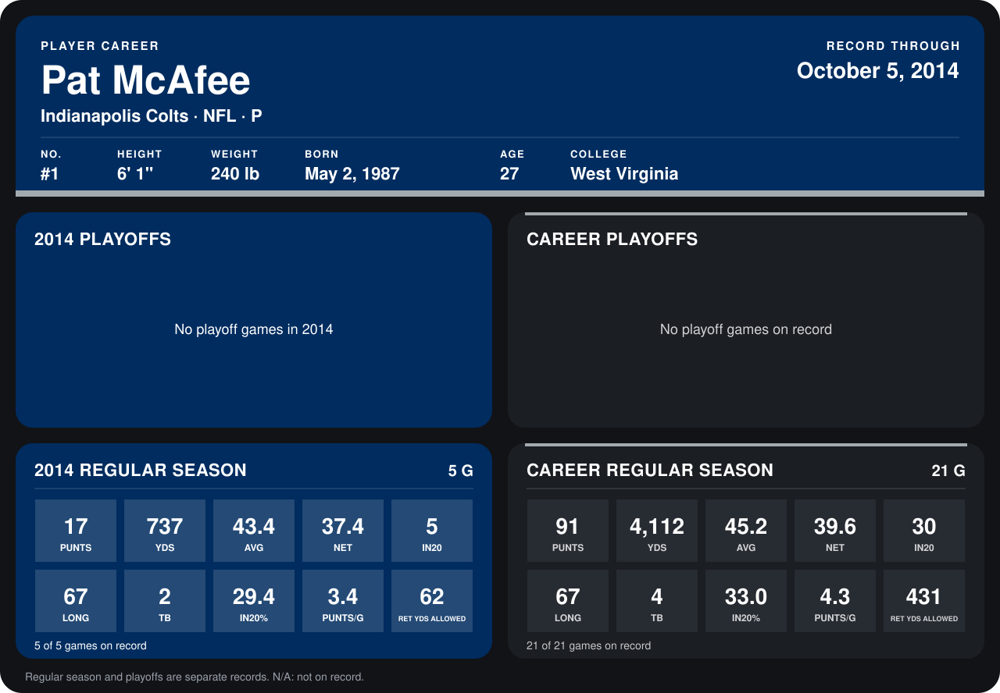

# Pat McAfee

## Career stats

### Regular season

| Season | Team | Age | # | G | PUNTS | YDS | AVG | NET | IN20 | LONG | TB | IN20% | PUNTS/G | RET YDS ALLOWED |
|---|---|---:|---:|---:|---:|---:|---:|---:|---:|---:|---:|---:|---:|---:|
| 2013 | Indianapolis Colts | 26 | 1 | 16 | 74 | 3,375 | 45.6 | 40.1 | 25 | 63 | 2 | 33.8 | 4.6 | 369 |
| 2014 | Indianapolis Colts | 27 | 1 | 4 | 12 | 526 | 43.8 | 37.0 | 3 | 67 | 1 | 25.0 | 3.0 | 62 |
| **Career** |  |  |  | 20 | 86 | 3,901 | 45.4 | 39.7 | 28 | 67 | 3 | 32.6 | 4.3 | 431 |

### Playoffs

No playoff games on record.

## Awards

None on record.

Age is his age on the league's opening game of each season; # is the number listed for him that season with that team (2014: the card's rule; 2013: the 2013 season roster), N/A where no listing applies.

Records through September 28, 2014. Identity: listed 2014 roster data, Weeks 1-4; number: 2014 Week 1 roster. [All Indianapolis Colts players](README.md).
