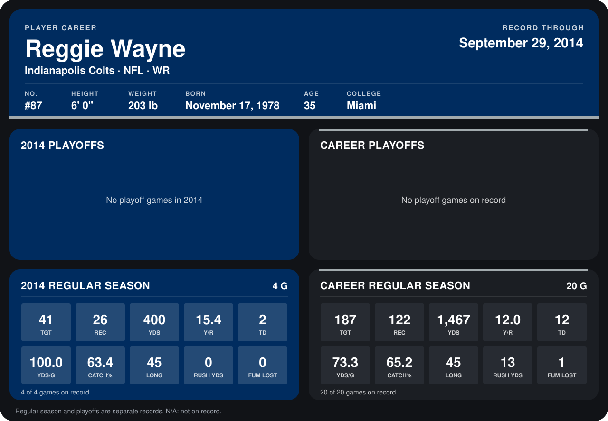

# Reggie Wayne

## Career stats

### Regular season

| Season | Team | Age | # | G | TGT | REC | YDS | Y/R | TD | YDS/G | CATCH% | LONG | RUSH YDS | FUM LOST |
|---|---|---:|---:|---:|---:|---:|---:|---:|---:|---:|---:|---:|---:|---:|
| 2013 | Indianapolis Colts | 34 | 87 | 16 | 146 | 96 | 1,067 | 11.1 | 10 | 66.7 | 65.8 | 45 | 13 | 1 |
| 2014 | Indianapolis Colts | 35 | 87 | 5 | 46 | 31 | 494 | 15.9 | 2 | 98.8 | 67.4 | 45 | 7 | 0 |
| **Career** |  |  |  | 21 | 192 | 127 | 1,561 | 12.3 | 12 | 74.3 | 66.1 | 45 | 20 | 1 |

### Playoffs

No playoff games on record.

## Awards

None on record.

Age is his age on the league's opening game of each season; # is the number listed for him that season with that team (2014: the card's rule; 2013: the 2013 season roster), N/A where no listing applies.

Records through October 5, 2014. Identity: listed 2014 roster data, Weeks 1-4; number: 2014 Week 1 roster. [All Indianapolis Colts players](README.md).
