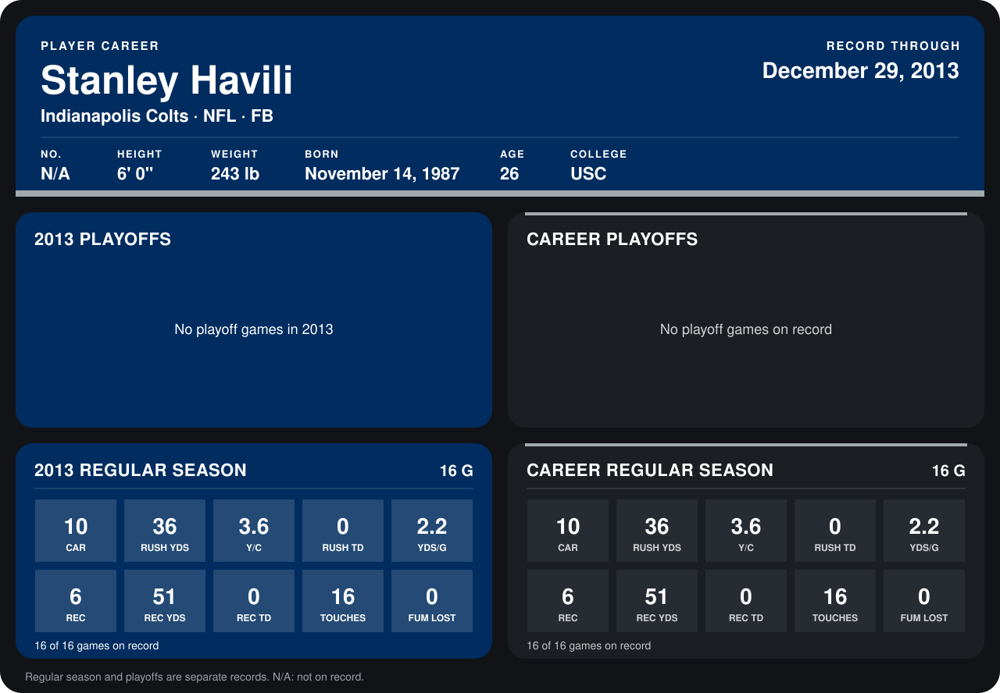

# Stanley Havili

## Career stats

### Regular season

| Season | Club | G | CAR | RUSH YDS | Y/C | RUSH TD | YDS/G | REC | REC YDS | REC TD | TOUCHES | FUM LOST |
|---|---|---:|---:|---:|---:|---:|---:|---:|---:|---:|---:|---:|
| 2013 | Indianapolis Colts | 16 | 10 | 36 | 3.6 | 0 | 2.2 | 6 | 51 | 0 | 16 | 0 |
| **Career** |  | 16 | 10 | 36 | 3.6 | 0 | 2.2 | 6 | 51 | 0 | 16 | 0 |

### Playoffs

No playoff games on record.

## Awards

None on record.

Records through December 29, 2013. Identity: his listed 2013 season roster data (no 2014 Weeks 1-4 roster row). [All Indianapolis Colts players](README.md).
