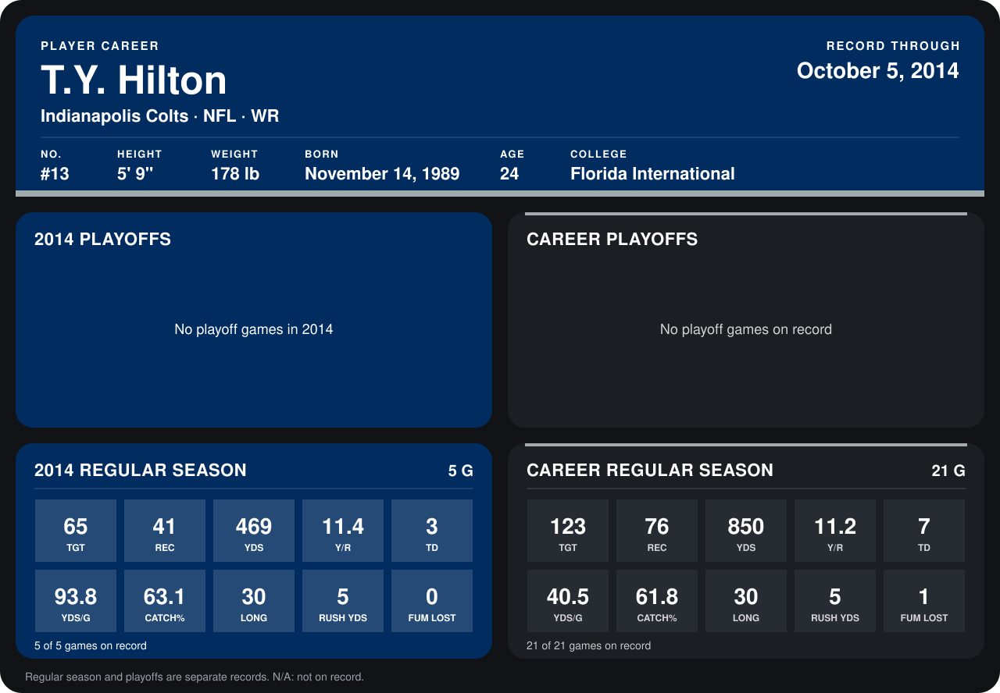

# T.Y. Hilton

## Career stats

### Regular season

| Season | Club | G | TGT | REC | YDS | Y/R | TD | YDS/G | CATCH% | LONG | RUSH YDS | FUM LOST |
|---|---|---:|---:|---:|---:|---:|---:|---:|---:|---:|---:|---:|
| 2013 | Indianapolis Colts | 16 | 58 | 35 | 381 | 10.9 | 4 | 23.8 | 60.3 | 29 | 0 | 1 |
| 2014 | Indianapolis Colts | 4 | 53 | 33 | 386 | 11.7 | 3 | 96.5 | 62.3 | 30 | 5 | 0 |
| **Career** |  | 20 | 111 | 68 | 767 | 11.3 | 7 | 38.4 | 61.3 | 30 | 5 | 1 |

### Playoffs

No playoff games on record.

## Awards

None on record.

Records through September 29, 2014. Identity: listed 2014 roster data, Weeks 1-4; number: 2014 Week 1 roster. [All Indianapolis Colts players](README.md).
