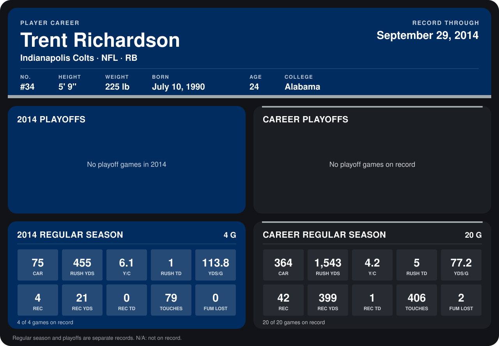

# Trent Richardson

## Career stats

### Regular season

| Season | Team | Age | # | G | CAR | RUSH YDS | Y/C | RUSH TD | YDS/G | REC | REC YDS | REC TD | TOUCHES | FUM LOST |
|---|---|---:|---:|---:|---:|---:|---:|---:|---:|---:|---:|---:|---:|---:|
| 2013 | Cleveland Browns | 23 | N/A | 16 | 289 | 1,088 | 3.8 | 4 | 68.0 | 38 | 378 | 1 | 327 | 2 |
| 2014 | Indianapolis Colts | 24 | 34 | 4 | 75 | 455 | 6.1 | 1 | 113.8 | 4 | 21 | 0 | 79 | 0 |
| **Career** |  |  |  | 20 | 364 | 1,543 | 4.2 | 5 | 77.2 | 42 | 399 | 1 | 406 | 2 |

### Playoffs

No playoff games on record.

## Awards

None on record.

Age is his age on the league's opening game of each season; # is the number listed for him that season with that team (2014: the card's rule; 2013: the 2013 season roster), N/A where no listing applies.

Records through September 28, 2014. Identity: listed 2014 roster data, Weeks 1-4; number: 2014 Week 1 roster. [All Indianapolis Colts players](README.md).
