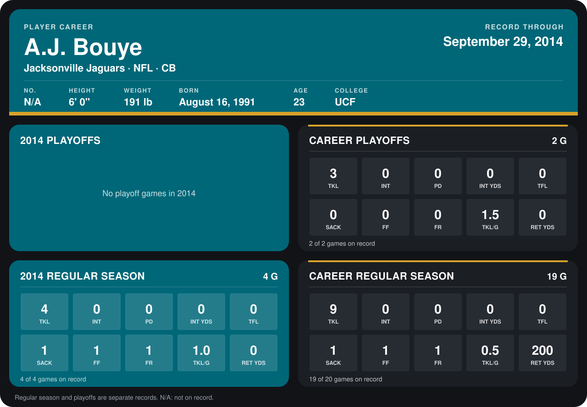

# A.J. Bouye

## Career stats

### Regular season

| Season | Club | G | TKL | INT | PD | INT YDS | TFL | SACK | FF | FR | TKL/G | RET YDS |
|---|---|---:|---:|---:|---:|---:|---:|---:|---:|---:|---:|---:|
| 2013 | Jacksonville Jaguars | 15 | 5 | 0 | 0 | 0 | 0 | 0 | 0 | 0 | 0.3 | 200 |
| 2014 | Jacksonville Jaguars | 4 | 4 | 0 | 0 | 0 | 0 | 1 | 1 | 1 | 1.0 | 0 |
| **Career** |  | 19 | 9 | 0 | 0 | 0 | 0 | 1 | 1 | 1 | 0.5 | 200 |

### Playoffs

| Season | Club | G | TKL | INT | PD | INT YDS | TFL | SACK | FF | FR | TKL/G | RET YDS |
|---|---|---:|---:|---:|---:|---:|---:|---:|---:|---:|---:|---:|
| 2013 | Jacksonville Jaguars | 2 | 3 | 0 | 0 | 0 | 0 | 0 | 0 | 0 | 1.5 | 0 |
| **Career** |  | 2 | 3 | 0 | 0 | 0 | 0 | 0 | 0 | 0 | 1.5 | 0 |

## Awards

None on record.

[Jacksonville player card](../../2014/00_Team_Operations/Team/Player_Cards/a_j_bouye.md)

Records through September 29, 2014. Identity: listed 2014 roster data, Weeks 1-4. [All Jacksonville Jaguars players](README.md).
