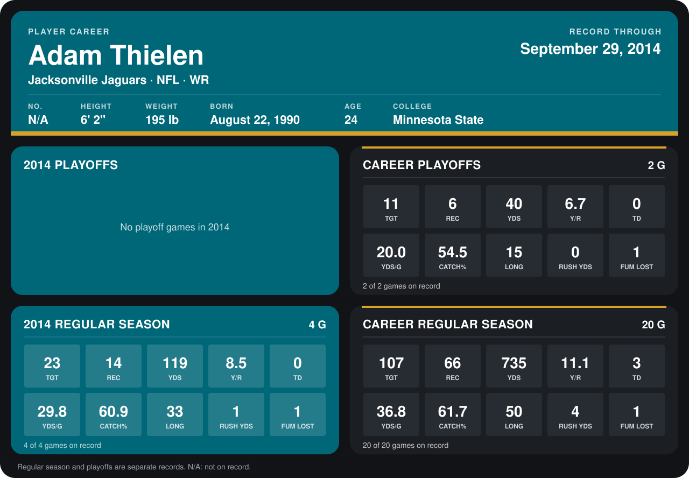

# Adam Thielen

## Career stats

### Regular season

| Season | Team | Age | # | G | TGT | REC | YDS | Y/R | TD | YDS/G | CATCH% | LONG | RUSH YDS | FUM LOST |
|---|---|---:|---:|---:|---:|---:|---:|---:|---:|---:|---:|---:|---:|---:|
| 2013 | Jacksonville Jaguars | 23 | N/A | 16 | 84 | 52 | 616 | 11.8 | 3 | 38.5 | 61.9 | 50 | 3 | 0 |
| 2014 | Jacksonville Jaguars | 24 | N/A | 5 | 28 | 19 | 168 | 8.8 | 0 | 33.6 | 67.9 | 33 | 1 | 1 |
| **Career** |  |  |  | 21 | 112 | 71 | 784 | 11.0 | 3 | 37.3 | 63.4 | 50 | 4 | 1 |

### Playoffs

| Season | Team | Age | # | G | TGT | REC | YDS | Y/R | TD | YDS/G | CATCH% | LONG | RUSH YDS | FUM LOST |
|---|---|---:|---:|---:|---:|---:|---:|---:|---:|---:|---:|---:|---:|---:|
| 2013 | Jacksonville Jaguars | 23 | N/A | 2 | 11 | 6 | 40 | 6.7 | 0 | 20.0 | 54.5 | 15 | 0 | 1 |
| **Career** |  |  |  | 2 | 11 | 6 | 40 | 6.7 | 0 | 20.0 | 54.5 | 15 | 0 | 1 |

## Awards

None on record.

[Jacksonville player card](../../2014/Team_Operations/Team/Player_Cards/adam_thielen.md)

Age is his age on the league's opening game of each season; # is the number listed for him that season with that team (2014: the card's rule; 2013: the 2013 season roster), N/A where no listing applies.

Records through October 5, 2014. Identity: listed 2014 roster data, Weeks 1-4. [All Jacksonville Jaguars players](README.md).
