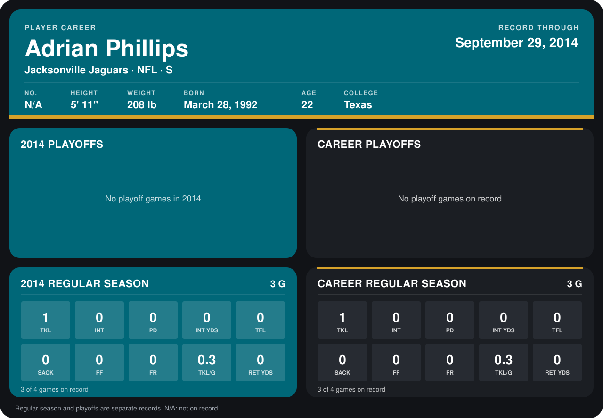

# Adrian Phillips

## Career stats

### Regular season

| Season | Club | G | TKL | INT | PD | INT YDS | TFL | SACK | FF | FR | TKL/G | RET YDS |
|---|---|---:|---:|---:|---:|---:|---:|---:|---:|---:|---:|---:|
| 2014 | Jacksonville Jaguars | 4 | 1 | 0 | 0 | 0 | 0 | 0 | 0 | 0 | 0.2 | 0 |
| **Career** |  | 4 | 1 | 0 | 0 | 0 | 0 | 0 | 0 | 0 | 0.2 | 0 |

### Playoffs

No playoff games on record.

## Awards

None on record.

[Jacksonville player card](../../2014/00_Team_Operations/Team/Player_Cards/adrian_phillips.md)

Records through October 5, 2014. Identity: the public player file's college (no 2014 Weeks 1-4 or 2013 roster row). [All Jacksonville Jaguars players](README.md).
