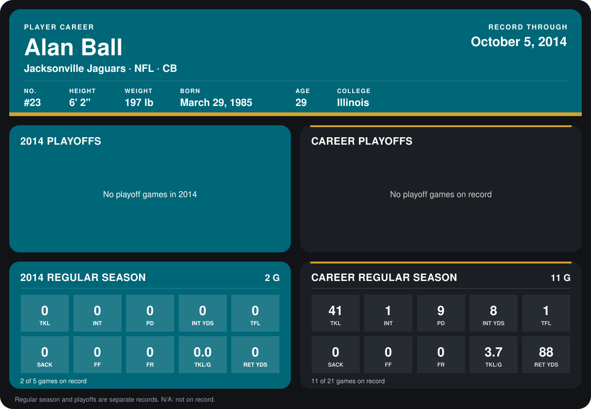

# Alan Ball

## Career stats

### Regular season

| Season | Team | Age | # | G | TKL | INT | PD | INT YDS | TFL | SACK | FF | FR | TKL/G | RET YDS |
|---|---|---:|---:|---:|---:|---:|---:|---:|---:|---:|---:|---:|---:|---:|
| 2013 | Jacksonville Jaguars | 28 | 23 | 9 | 41 | 1 | 9 | 8 | 1 | 0 | 0 | 0 | 4.6 | 88 |
| 2014 | Jacksonville Jaguars | 29 | 23 | 2 | 0 | 0 | 0 | 0 | 0 | 0 | 0 | 0 | 0.0 | 0 |
| **Career** |  |  |  | 11 | 41 | 1 | 9 | 8 | 1 | 0 | 0 | 0 | 3.7 | 88 |

### Playoffs

No playoff games on record.

## Awards

None on record.

[Jacksonville player card](../../2014/Team_Operations/Team/Player_Cards/alan_ball.md)

Age is his age on the league's opening game of each season; # is the number listed for him that season with that team (2014: the card's rule; 2013: the 2013 season roster), N/A where no listing applies.

Records through October 5, 2014. Identity: listed 2014 roster data, Weeks 1-4; number: his 2014 Jaguars roster listing. [All Jacksonville Jaguars players](README.md).
