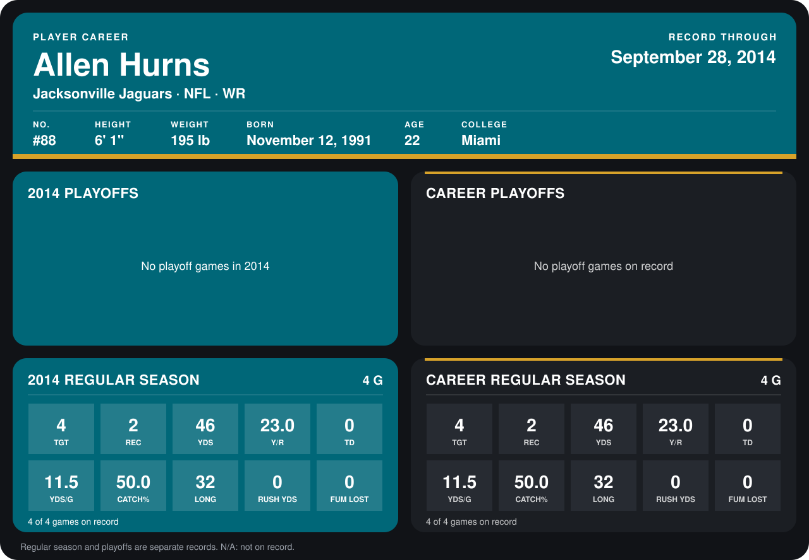

# Allen Hurns

## Career stats

### Regular season

| Season | Club | G | TGT | REC | YDS | Y/R | TD | YDS/G | CATCH% | LONG | RUSH YDS | FUM LOST |
|---|---|---:|---:|---:|---:|---:|---:|---:|---:|---:|---:|---:|
| 2014 | Jacksonville Jaguars | 5 | 5 | 3 | 48 | 16.0 | 0 | 9.6 | 60.0 | 32 | 0 | 0 |
| **Career** |  | 5 | 5 | 3 | 48 | 16.0 | 0 | 9.6 | 60.0 | 32 | 0 | 0 |

### Playoffs

No playoff games on record.

## Awards

None on record.

[Jacksonville player card](../../2014/00_Team_Operations/Team/Player_Cards/allen_hurns.md)

Records through October 5, 2014. Identity: listed 2014 roster data, Weeks 1-4; number: his 2014 Jaguars roster listing. [All Jacksonville Jaguars players](README.md).
