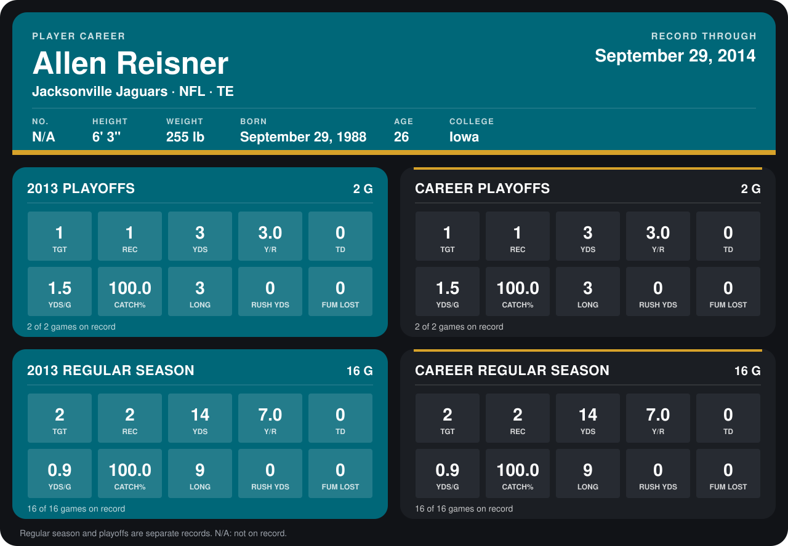

# Allen Reisner

## Career stats

### Regular season

| Season | Club | G | TGT | REC | YDS | Y/R | TD | YDS/G | CATCH% | LONG | RUSH YDS | FUM LOST |
|---|---|---:|---:|---:|---:|---:|---:|---:|---:|---:|---:|---:|
| 2013 | Jacksonville Jaguars | 16 | 2 | 2 | 14 | 7.0 | 0 | 0.9 | 100.0 | 9 | 0 | 0 |
| **Career** |  | 16 | 2 | 2 | 14 | 7.0 | 0 | 0.9 | 100.0 | 9 | 0 | 0 |

### Playoffs

| Season | Club | G | TGT | REC | YDS | Y/R | TD | YDS/G | CATCH% | LONG | RUSH YDS | FUM LOST |
|---|---|---:|---:|---:|---:|---:|---:|---:|---:|---:|---:|---:|
| 2013 | Jacksonville Jaguars | 2 | 1 | 1 | 3 | 3.0 | 0 | 1.5 | 100.0 | 3 | 0 | 0 |
| **Career** |  | 2 | 1 | 1 | 3 | 3.0 | 0 | 1.5 | 100.0 | 3 | 0 | 0 |

## Awards

None on record.

Records through September 29, 2014. Identity: the public player file's latest listing (no 2014 Weeks 1-4 roster row). [All Jacksonville Jaguars players](README.md).
