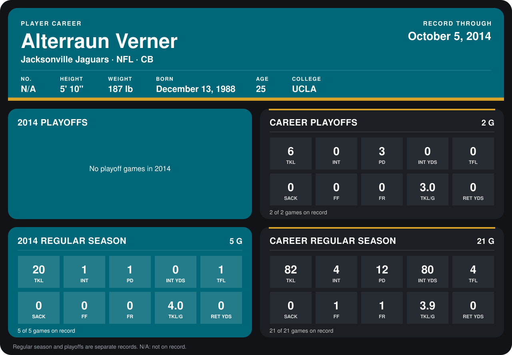

# Alterraun Verner

## Career stats

### Regular season

| Season | Club | G | TKL | INT | PD | INT YDS | TFL | SACK | FF | FR | TKL/G | RET YDS |
|---|---|---:|---:|---:|---:|---:|---:|---:|---:|---:|---:|---:|
| 2013 | Tennessee Titans | 16 | 62 | 3 | 11 | 80 | 3 | 0 | 1 | 1 | 3.9 | 0 |
| 2014 | Jacksonville Jaguars | 5 | 20 | 1 | 1 | 0 | 1 | 0 | 0 | 0 | 4.0 | 0 |
| **Career** |  | 21 | 82 | 4 | 12 | 80 | 4 | 0 | 1 | 1 | 3.9 | 0 |

### Playoffs

| Season | Club | G | TKL | INT | PD | INT YDS | TFL | SACK | FF | FR | TKL/G | RET YDS |
|---|---|---:|---:|---:|---:|---:|---:|---:|---:|---:|---:|---:|
| 2013 | Tennessee Titans | 2 | 6 | 0 | 3 | 0 | 0 | 0 | 0 | 0 | 3.0 | 0 |
| **Career** |  | 2 | 6 | 0 | 3 | 0 | 0 | 0 | 0 | 0 | 3.0 | 0 |

## Awards

None on record.

[Jacksonville player card](../../2014/00_Team_Operations/Team/Player_Cards/alterraun_verner.md)

Records through October 5, 2014. Identity: listed 2014 roster data, Weeks 1-4. [All Jacksonville Jaguars players](README.md).
