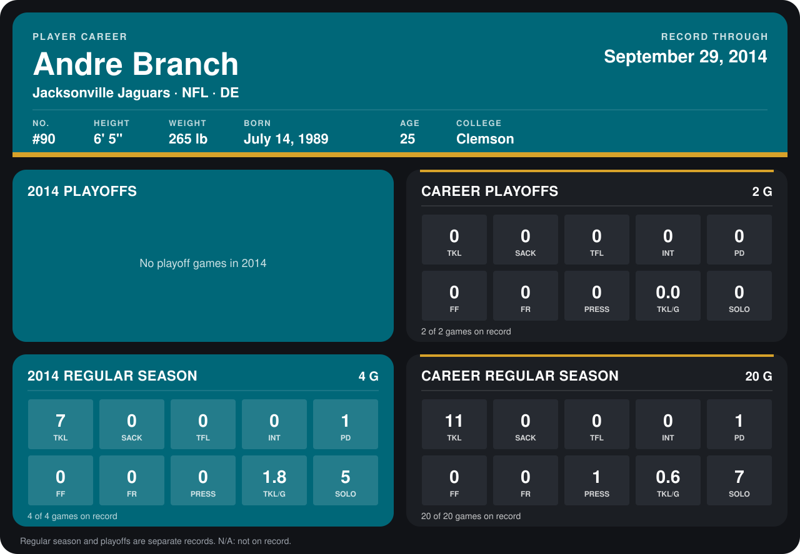

# Andre Branch

## Career stats

### Regular season

| Season | Club | G | TKL | SACK | TFL | INT | PD | FF | FR | PRESS | TKL/G | SOLO |
|---|---|---:|---:|---:|---:|---:|---:|---:|---:|---:|---:|---:|
| 2013 | Jacksonville Jaguars | 16 | 4 | 0 | 0 | 0 | 0 | 0 | 0 | 1 | 0.2 | 2 |
| 2014 | Jacksonville Jaguars | 4 | 7 | 0 | 0 | 0 | 1 | 0 | 0 | 0 | 1.8 | 5 |
| **Career** |  | 20 | 11 | 0 | 0 | 0 | 1 | 0 | 0 | 1 | 0.6 | 7 |

### Playoffs

| Season | Club | G | TKL | SACK | TFL | INT | PD | FF | FR | PRESS | TKL/G | SOLO |
|---|---|---:|---:|---:|---:|---:|---:|---:|---:|---:|---:|---:|
| 2013 | Jacksonville Jaguars | 2 | 0 | 0 | 0 | 0 | 0 | 0 | 0 | 0 | 0.0 | 0 |
| **Career** |  | 2 | 0 | 0 | 0 | 0 | 0 | 0 | 0 | 0 | 0.0 | 0 |

## Awards

None on record.

[Jacksonville player card](../../2014/00_Team_Operations/Team/Player_Cards/andre_branch.md)

Records through September 29, 2014. Identity: listed 2014 roster data, Weeks 1-4; number: his 2014 Jaguars roster listing. [All Jacksonville Jaguars players](README.md).
