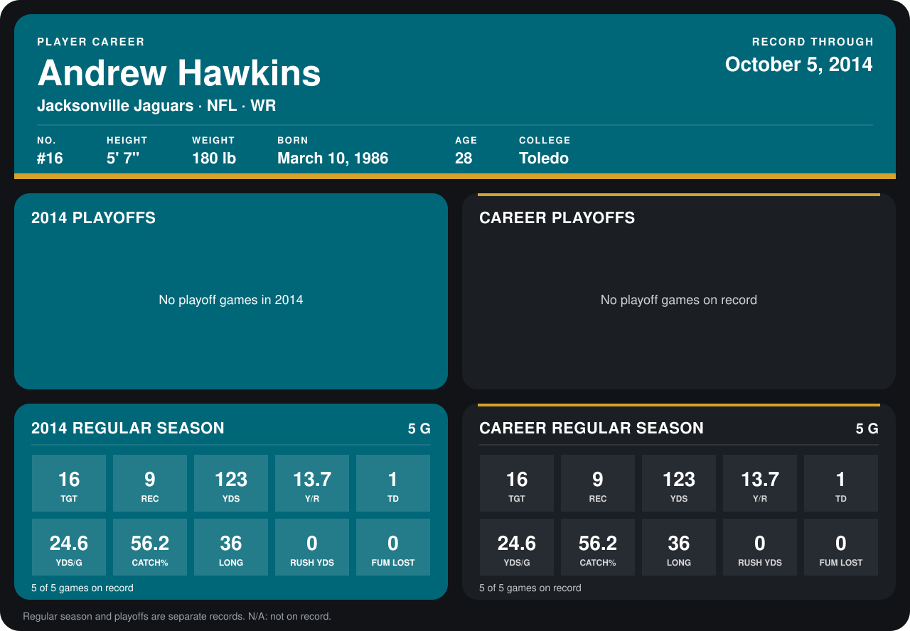

# Andrew Hawkins

## Career stats

### Regular season

| Season | Club | G | TGT | REC | YDS | Y/R | TD | YDS/G | CATCH% | LONG | RUSH YDS | FUM LOST |
|---|---|---:|---:|---:|---:|---:|---:|---:|---:|---:|---:|---:|
| 2014 | Jacksonville Jaguars | 5 | 16 | 9 | 123 | 13.7 | 1 | 24.6 | 56.2 | 36 | 0 | 0 |
| **Career** |  | 5 | 16 | 9 | 123 | 13.7 | 1 | 24.6 | 56.2 | 36 | 0 | 0 |

### Playoffs

No playoff games on record.

## Awards

None on record.

[Jacksonville player card](../../2014/00_Team_Operations/Team/Player_Cards/andrew_hawkins.md)

Records through October 5, 2014. Identity: listed 2014 roster data, Weeks 1-4; number: the number he wore in 2014 with the Cleveland Browns (Jacksonville has not recorded one). [All Jacksonville Jaguars players](README.md).
