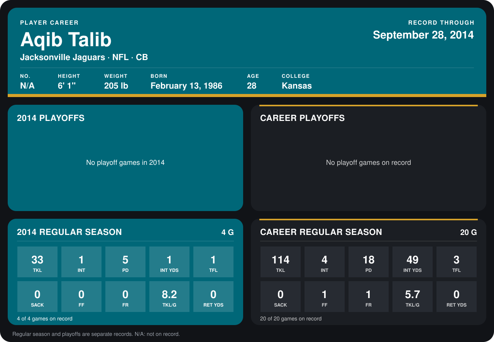

# Aqib Talib

## Career stats

### Regular season

| Season | Team | Age | # | G | TKL | INT | PD | INT YDS | TFL | SACK | FF | FR | TKL/G | RET YDS |
|---|---|---:|---:|---:|---:|---:|---:|---:|---:|---:|---:|---:|---:|---:|
| 2013 | New England Patriots | 27 | 31 | 16 | 81 | 3 | 13 | 48 | 2 | 0 | 1 | 1 | 5.1 | 0 |
| 2014 | Jacksonville Jaguars | 28 | N/A | 4 | 33 | 1 | 5 | 1 | 1 | 0 | 0 | 0 | 8.2 | 0 |
| **Career** |  |  |  | 20 | 114 | 4 | 18 | 49 | 3 | 0 | 1 | 1 | 5.7 | 0 |

### Playoffs

No playoff games on record.

## Awards

None on record.

[Jacksonville player card](../../2014/00_Team_Operations/Team/Player_Cards/aqib_talib.md)

Age is his age on the league's opening game of each season; # is the number listed for him that season with that team (2014: the card's rule; 2013: the 2013 season roster), N/A where no listing applies.

Records through September 28, 2014. Identity: listed 2014 roster data, Weeks 1-4. [All Jacksonville Jaguars players](README.md).
