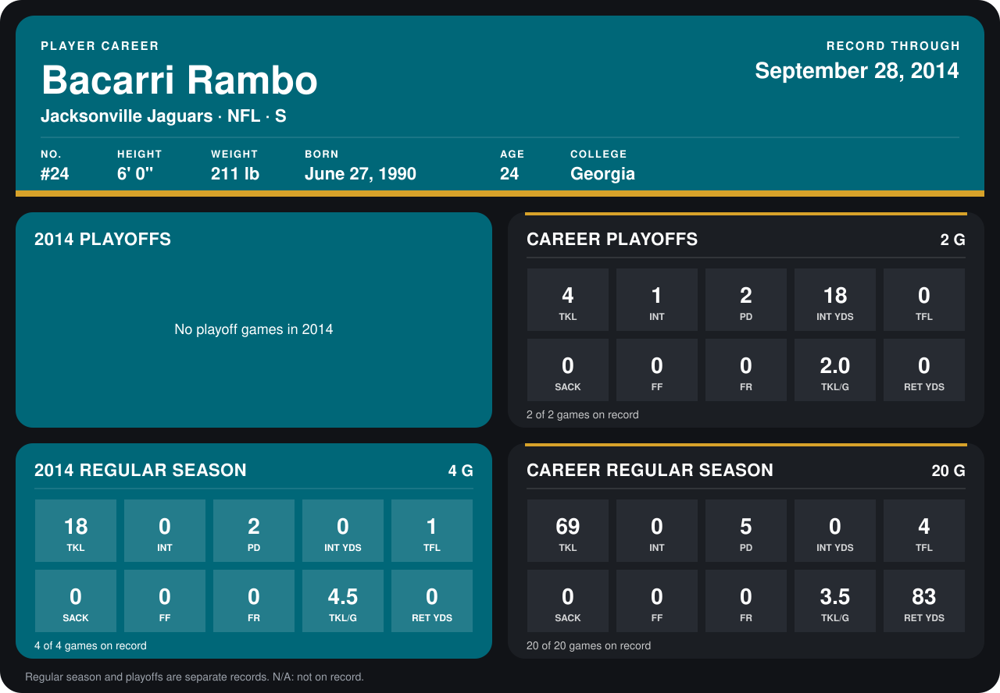

# Bacarri Rambo

## Career stats

### Regular season

| Season | Club | G | TKL | INT | PD | INT YDS | TFL | SACK | FF | FR | TKL/G | RET YDS |
|---|---|---:|---:|---:|---:|---:|---:|---:|---:|---:|---:|---:|
| 2013 | Jacksonville Jaguars | 16 | 51 | 0 | 3 | 0 | 3 | 0 | 0 | 0 | 3.2 | 83 |
| 2014 | Jacksonville Jaguars | 5 | 20 | 0 | 3 | 0 | 1 | 0 | 0 | 0 | 4.0 | 0 |
| **Career** |  | 21 | 71 | 0 | 6 | 0 | 4 | 0 | 0 | 0 | 3.4 | 83 |

### Playoffs

| Season | Club | G | TKL | INT | PD | INT YDS | TFL | SACK | FF | FR | TKL/G | RET YDS |
|---|---|---:|---:|---:|---:|---:|---:|---:|---:|---:|---:|---:|
| 2013 | Jacksonville Jaguars | 2 | 4 | 1 | 2 | 18 | 0 | 0 | 0 | 0 | 2.0 | 0 |
| **Career** |  | 2 | 4 | 1 | 2 | 18 | 0 | 0 | 0 | 0 | 2.0 | 0 |

## Awards

None on record.

[Jacksonville player card](../../2014/00_Team_Operations/Team/Player_Cards/bacarri_rambo.md)

Records through October 5, 2014. Identity: listed 2014 roster data, Weeks 1-4; number: the number he wore in 2014 with the Washington Redskins (Jacksonville has not recorded one). [All Jacksonville Jaguars players](README.md).
