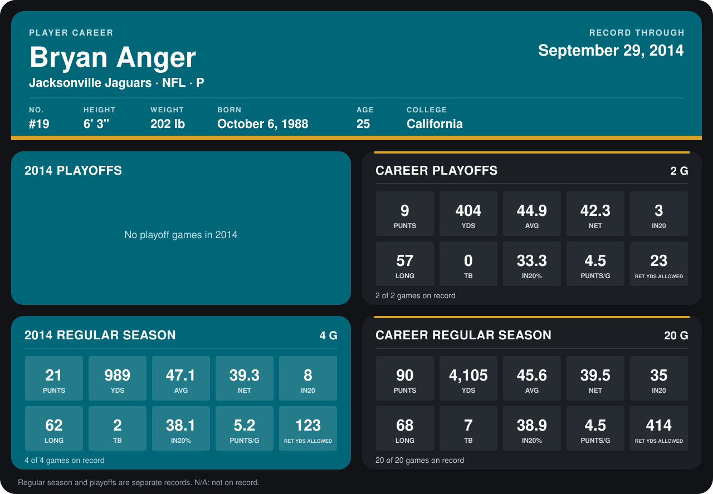

# Bryan Anger

## Career stats

### Regular season

| Season | Team | Age | # | G | PUNTS | YDS | AVG | NET | IN20 | LONG | TB | IN20% | PUNTS/G | RET YDS ALLOWED |
|---|---|---:|---:|---:|---:|---:|---:|---:|---:|---:|---:|---:|---:|---:|
| 2013 | Jacksonville Jaguars | 24 | 19 | 16 | 69 | 3,116 | 45.2 | 39.5 | 27 | 68 | 5 | 39.1 | 4.3 | 291 |
| 2014 | Jacksonville Jaguars | 25 | 19 | 5 | 25 | 1,139 | 45.6 | 37.9 | 10 | 62 | 3 | 40.0 | 5.0 | 131 |
| **Career** |  |  |  | 21 | 94 | 4,255 | 45.3 | 39.1 | 37 | 68 | 8 | 39.4 | 4.5 | 422 |

### Playoffs

| Season | Team | Age | # | G | PUNTS | YDS | AVG | NET | IN20 | LONG | TB | IN20% | PUNTS/G | RET YDS ALLOWED |
|---|---|---:|---:|---:|---:|---:|---:|---:|---:|---:|---:|---:|---:|---:|
| 2013 | Jacksonville Jaguars | 24 | 19 | 2 | 9 | 404 | 44.9 | 42.3 | 3 | 57 | 0 | 33.3 | 4.5 | 23 |
| **Career** |  |  |  | 2 | 9 | 404 | 44.9 | 42.3 | 3 | 57 | 0 | 33.3 | 4.5 | 23 |

## Awards

None on record.

[Jacksonville player card](../../2014/Team_Operations/Team/Player_Cards/bryan_anger.md)

Age is his age on the league's opening game of each season; # is the number listed for him that season with that team (2014: the card's rule; 2013: the 2013 season roster), N/A where no listing applies.

Records through October 5, 2014. Identity: listed 2014 roster data, Weeks 1-4; number: his 2014 Jaguars roster listing. [All Jacksonville Jaguars players](README.md).
