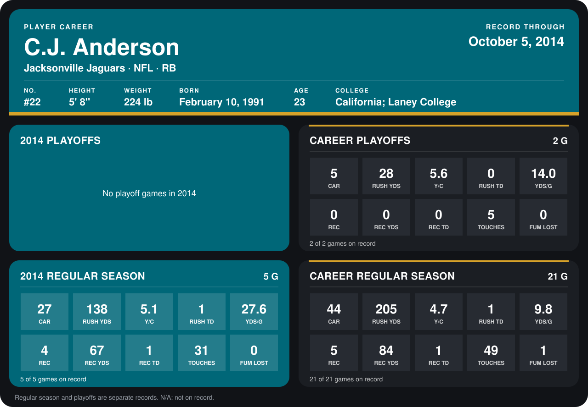

# C.J. Anderson

## Career stats

### Regular season

| Season | Team | Age | # | G | CAR | RUSH YDS | Y/C | RUSH TD | YDS/G | REC | REC YDS | REC TD | TOUCHES | FUM LOST |
|---|---|---:|---:|---:|---:|---:|---:|---:|---:|---:|---:|---:|---:|---:|
| 2013 | Jacksonville Jaguars | 22 | N/A | 16 | 17 | 67 | 3.9 | 0 | 4.2 | 1 | 17 | 0 | 18 | 1 |
| 2014 | Jacksonville Jaguars | 23 | 22 | 5 | 27 | 138 | 5.1 | 1 | 27.6 | 4 | 67 | 1 | 31 | 0 |
| **Career** |  |  |  | 21 | 44 | 205 | 4.7 | 1 | 9.8 | 5 | 84 | 1 | 49 | 1 |

### Playoffs

| Season | Team | Age | # | G | CAR | RUSH YDS | Y/C | RUSH TD | YDS/G | REC | REC YDS | REC TD | TOUCHES | FUM LOST |
|---|---|---:|---:|---:|---:|---:|---:|---:|---:|---:|---:|---:|---:|---:|
| 2013 | Jacksonville Jaguars | 22 | N/A | 2 | 5 | 28 | 5.6 | 0 | 14.0 | 0 | 0 | 0 | 5 | 0 |
| **Career** |  |  |  | 2 | 5 | 28 | 5.6 | 0 | 14.0 | 0 | 0 | 0 | 5 | 0 |

## Awards

None on record.

[Jacksonville player card](../../2014/Team_Operations/Team/Player_Cards/c_j_anderson.md)

Age is his age on the league's opening game of each season; # is the number listed for him that season with that team (2014: the card's rule; 2013: the 2013 season roster), N/A where no listing applies.

Records through October 5, 2014. Identity: listed 2014 roster data, Weeks 1-4; number: the number he wore in 2014 with the Denver Broncos (Jacksonville has not recorded one). [All Jacksonville Jaguars players](README.md).
