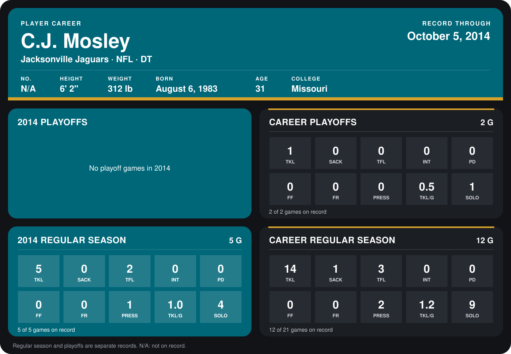

# C.J. Mosley

## Career stats

### Regular season

| Season | Team | Age | # | G | TKL | SACK | TFL | INT | PD | FF | FR | PRESS | TKL/G | SOLO |
|---|---|---:|---:|---:|---:|---:|---:|---:|---:|---:|---:|---:|---:|---:|
| 2013 | Jacksonville Jaguars | 30 | N/A | 7 | 9 | 1 | 1 | 0 | 0 | 0 | 0 | 1 | 1.3 | 5 |
| 2014 | Jacksonville Jaguars | 31 | N/A | 5 | 5 | 0 | 2 | 0 | 0 | 0 | 0 | 1 | 1.0 | 4 |
| **Career** |  |  |  | 12 | 14 | 1 | 3 | 0 | 0 | 0 | 0 | 2 | 1.2 | 9 |

### Playoffs

| Season | Team | Age | # | G | TKL | SACK | TFL | INT | PD | FF | FR | PRESS | TKL/G | SOLO |
|---|---|---:|---:|---:|---:|---:|---:|---:|---:|---:|---:|---:|---:|---:|
| 2013 | Jacksonville Jaguars | 30 | N/A | 2 | 1 | 0 | 0 | 0 | 0 | 0 | 0 | 0 | 0.5 | 1 |
| **Career** |  |  |  | 2 | 1 | 0 | 0 | 0 | 0 | 0 | 0 | 0 | 0.5 | 1 |

## Awards

None on record.

[Jacksonville player card](../../2014/Team_Operations/Team/Player_Cards/c_j_mosley.md)

Age is his age on the league's opening game of each season; # is the number listed for him that season with that team (2014: the card's rule; 2013: the 2013 season roster), N/A where no listing applies.

Records through October 5, 2014. Identity: listed 2014 roster data, Weeks 1-4. [All Jacksonville Jaguars players](README.md).
