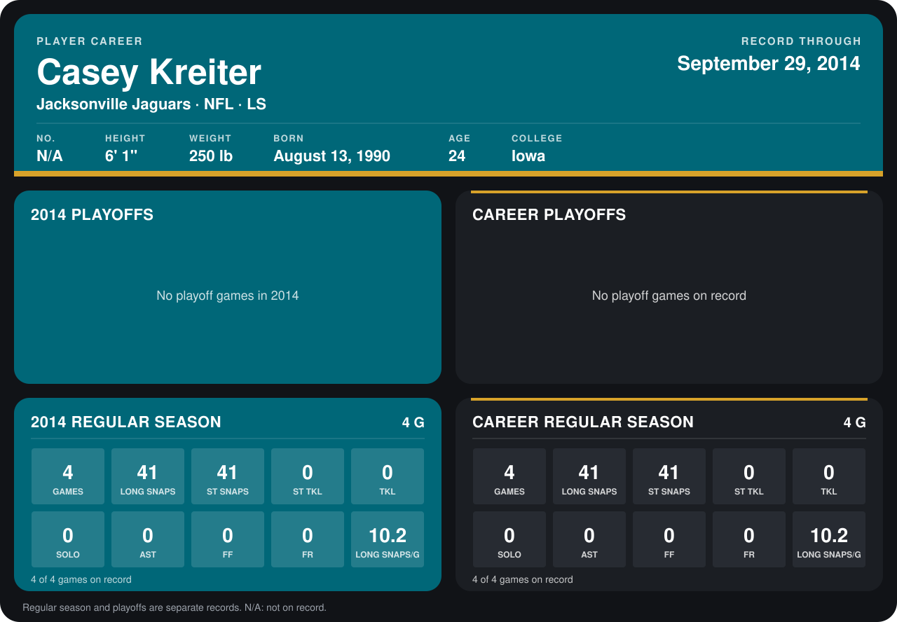

# Casey Kreiter

## Career stats

### Regular season

| Season | Club | G | LONG SNAPS | ST SNAPS | ST TKL | TKL | SOLO | AST | FF | FR | LONG SNAPS/G |
|---|---|---:|---:|---:|---:|---:|---:|---:|---:|---:|---:|
| 2014 | Jacksonville Jaguars | 4 | 41 | 41 | 0 | 0 | 0 | 0 | 0 | 0 | 10.2 |
| **Career** |  | 4 | 41 | 41 | 0 | 0 | 0 | 0 | 0 | 0 | 10.2 |

### Playoffs

No playoff games on record.

## Awards

None on record.

[Jacksonville player card](../../2014/00_Team_Operations/Team/Player_Cards/casey_kreiter.md)

Records through September 28, 2014. Identity: the public player file's college (no 2014 Weeks 1-4 or 2013 roster row). [All Jacksonville Jaguars players](README.md).
