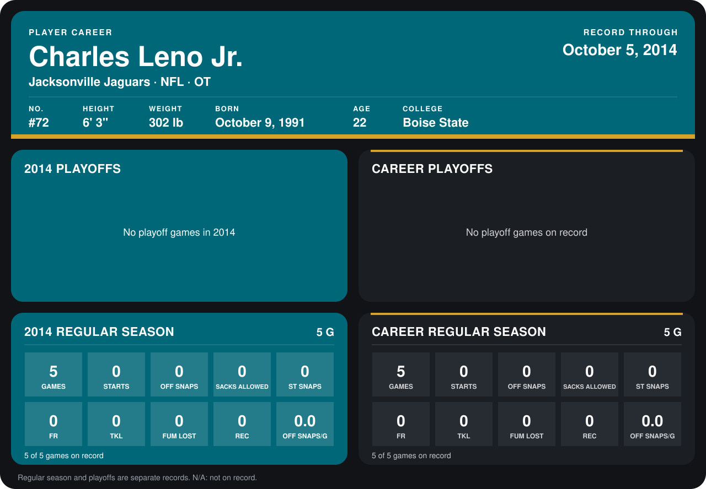

# Charles Leno Jr.

## Career stats

### Regular season

| Season | Club | G | STARTS | OFF SNAPS | SACKS ALLOWED | ST SNAPS | FR | TKL | FUM LOST | REC | OFF SNAPS/G |
|---|---|---:|---:|---:|---:|---:|---:|---:|---:|---:|---:|
| 2014 | Jacksonville Jaguars | 5 | 0 | 0 | 0 | 0 | 0 | 0 | 0 | 0 | 0.0 |
| **Career** |  | 5 | 0 | 0 | 0 | 0 | 0 | 0 | 0 | 0 | 0.0 |

### Playoffs

No playoff games on record.

## Awards

None on record.

[Jacksonville player card](../../2014/00_Team_Operations/Team/Player_Cards/charles_leno_jr.md)

Records through October 5, 2014. Identity: listed 2014 roster data, Weeks 1-4; number: the number he wore in 2014 with the Chicago Bears (Jacksonville has not recorded one). [All Jacksonville Jaguars players](README.md).
