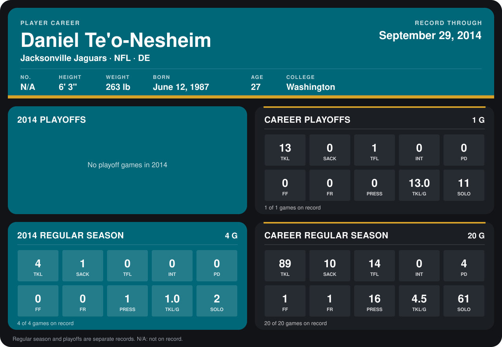

# Daniel Te'o-Nesheim

## Career stats

### Regular season

| Season | Team | Age | # | G | TKL | SACK | TFL | INT | PD | FF | FR | PRESS | TKL/G | SOLO |
|---|---|---:|---:|---:|---:|---:|---:|---:|---:|---:|---:|---:|---:|---:|
| 2013 | Tampa Bay Buccaneers | 26 | 50 | 16 | 85 | 9 | 14 | 0 | 4 | 1 | 1 | 15 | 5.3 | 59 |
| 2014 | Jacksonville Jaguars | 27 | N/A | 5 | 4 | 1 | 0 | 0 | 0 | 0 | 0 | 1 | 0.8 | 2 |
| **Career** |  |  |  | 21 | 89 | 10 | 14 | 0 | 4 | 1 | 1 | 16 | 4.2 | 61 |

### Playoffs

| Season | Team | Age | # | G | TKL | SACK | TFL | INT | PD | FF | FR | PRESS | TKL/G | SOLO |
|---|---|---:|---:|---:|---:|---:|---:|---:|---:|---:|---:|---:|---:|---:|
| 2013 | Tampa Bay Buccaneers | 26 | 50 | 1 | 13 | 0 | 1 | 0 | 0 | 0 | 0 | 0 | 13.0 | 11 |
| **Career** |  |  |  | 1 | 13 | 0 | 1 | 0 | 0 | 0 | 0 | 0 | 13.0 | 11 |

## Awards

- Pro Bowl selection, replacement (2013, DE)

[Jacksonville player card](../../2014/Team_Operations/Team/Player_Cards/daniel_te_o_nesheim.md)

Age is his age on the league's opening game of each season; # is the number listed for him that season with that team (2014: the card's rule; 2013: the 2013 season roster), N/A where no listing applies.

Records through October 5, 2014. Identity: his listed 2013 season roster data (no 2014 Weeks 1-4 roster row). [All Jacksonville Jaguars players](README.md).
