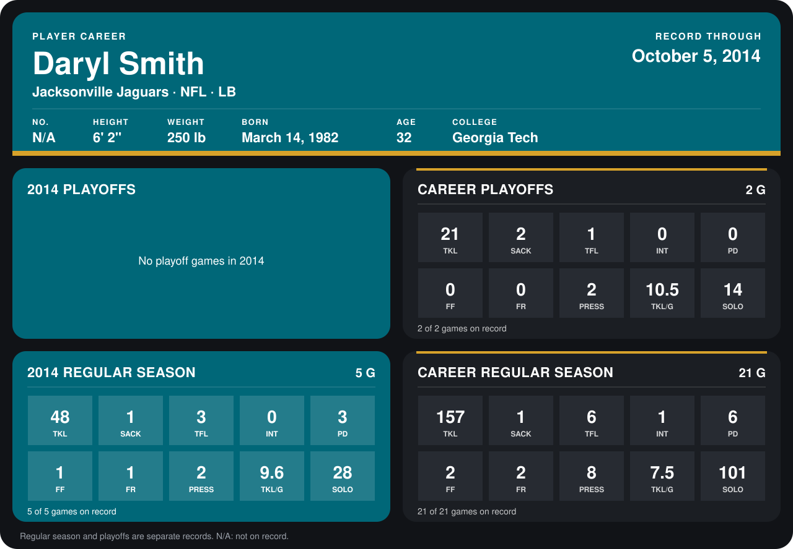

# Daryl Smith

## Career stats

### Regular season

| Season | Club | G | TKL | SACK | TFL | INT | PD | FF | FR | PRESS | TKL/G | SOLO |
|---|---|---:|---:|---:|---:|---:|---:|---:|---:|---:|---:|---:|
| 2013 | Jacksonville Jaguars | 16 | 109 | 0 | 3 | 1 | 3 | 1 | 1 | 6 | 6.8 | 73 |
| 2014 | Jacksonville Jaguars | 4 | 36 | 1 | 3 | 0 | 1 | 0 | 0 | 1 | 9.0 | 22 |
| **Career** |  | 20 | 145 | 1 | 6 | 1 | 4 | 1 | 1 | 7 | 7.2 | 95 |

### Playoffs

| Season | Club | G | TKL | SACK | TFL | INT | PD | FF | FR | PRESS | TKL/G | SOLO |
|---|---|---:|---:|---:|---:|---:|---:|---:|---:|---:|---:|---:|
| 2013 | Jacksonville Jaguars | 2 | 21 | 2 | 1 | 0 | 0 | 0 | 0 | 2 | 10.5 | 14 |
| **Career** |  | 2 | 21 | 2 | 1 | 0 | 0 | 0 | 0 | 2 | 10.5 | 14 |

## Awards

None on record.

[Jacksonville player card](../../2014/00_Team_Operations/Team/Player_Cards/daryl_smith.md)

Records through September 28, 2014. Identity: listed 2014 roster data, Weeks 1-4. [All Jacksonville Jaguars players](README.md).
