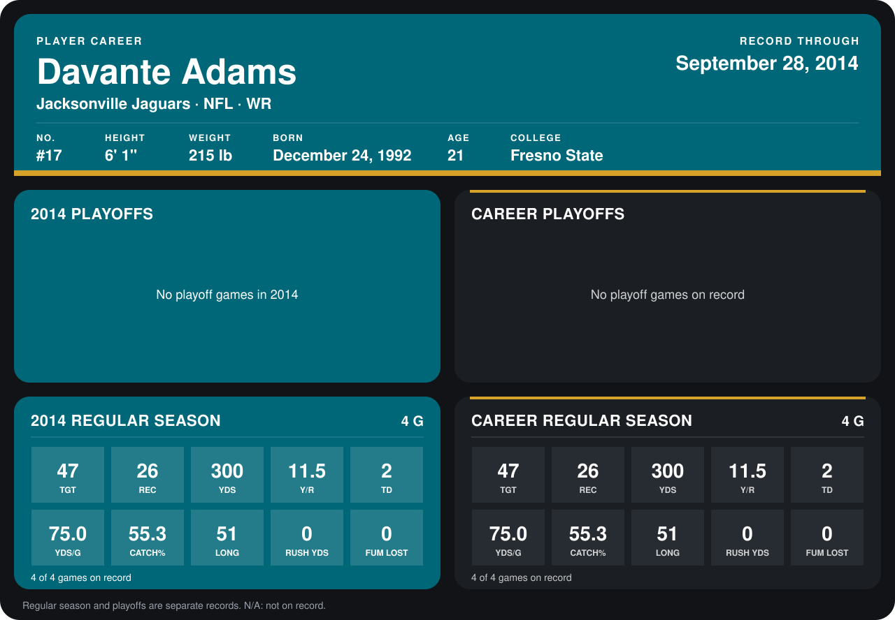

# Davante Adams

## Career stats

### Regular season

| Season | Team | Age | # | G | TGT | REC | YDS | Y/R | TD | YDS/G | CATCH% | LONG | RUSH YDS | FUM LOST |
|---|---|---:|---:|---:|---:|---:|---:|---:|---:|---:|---:|---:|---:|---:|
| 2014 | Jacksonville Jaguars | 21 | 17 | 5 | 52 | 30 | 369 | 12.3 | 2 | 73.8 | 57.7 | 64 | 2 | 0 |
| **Career** |  |  |  | 5 | 52 | 30 | 369 | 12.3 | 2 | 73.8 | 57.7 | 64 | 2 | 0 |

### Playoffs

No playoff games on record.

## Awards

None on record.

[Jacksonville player card](../../2014/Team_Operations/Team/Player_Cards/davante_adams.md)

Age is his age on the league's opening game of each season; # is the number listed for him that season with that team (2014: the card's rule; 2013: the 2013 season roster), N/A where no listing applies.

Records through October 5, 2014. Identity: listed 2014 roster data, Weeks 1-4; number: the number he wore in 2014 with the Green Bay Packers (Jacksonville has not recorded one). [All Jacksonville Jaguars players](README.md).
