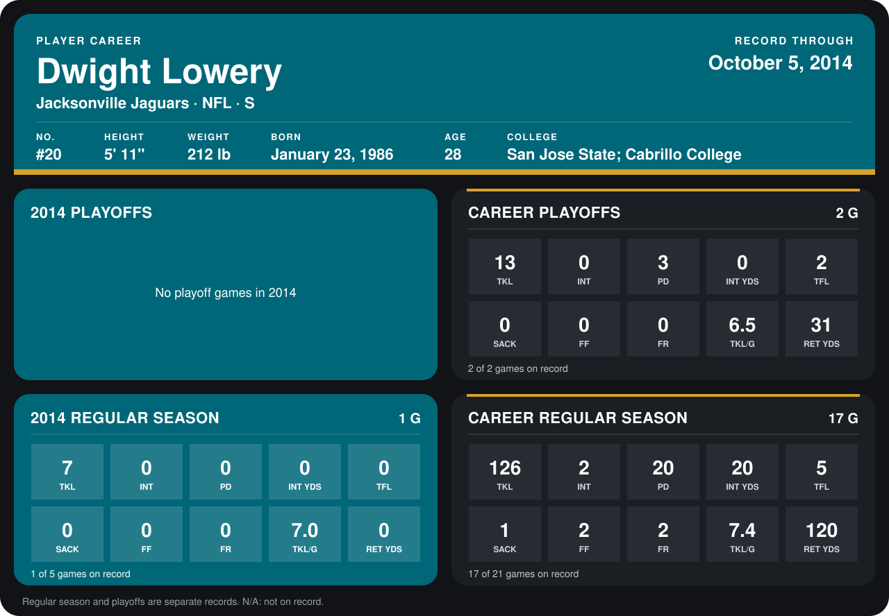

# Dwight Lowery

## Career stats

### Regular season

| Season | Club | G | TKL | INT | PD | INT YDS | TFL | SACK | FF | FR | TKL/G | RET YDS |
|---|---|---:|---:|---:|---:|---:|---:|---:|---:|---:|---:|---:|
| 2013 | Jacksonville Jaguars | 16 | 119 | 2 | 20 | 20 | 5 | 1 | 2 | 2 | 7.4 | 120 |
| 2014 | Jacksonville Jaguars | 1 | 7 | 0 | 0 | 0 | 0 | 0 | 0 | 0 | 7.0 | 0 |
| **Career** |  | 17 | 126 | 2 | 20 | 20 | 5 | 1 | 2 | 2 | 7.4 | 120 |

### Playoffs

| Season | Club | G | TKL | INT | PD | INT YDS | TFL | SACK | FF | FR | TKL/G | RET YDS |
|---|---|---:|---:|---:|---:|---:|---:|---:|---:|---:|---:|---:|
| 2013 | Jacksonville Jaguars | 2 | 13 | 0 | 3 | 0 | 2 | 0 | 0 | 0 | 6.5 | 31 |
| **Career** |  | 2 | 13 | 0 | 3 | 0 | 2 | 0 | 0 | 0 | 6.5 | 31 |

## Awards

None on record.

[Jacksonville player card](../../2014/00_Team_Operations/Team/Player_Cards/dwight_lowery.md)

Records through October 5, 2014. Identity: listed 2014 roster data, Weeks 1-4; number: the number he wore in 2014 with the Atlanta Falcons (Jacksonville has not recorded one). [All Jacksonville Jaguars players](README.md).
