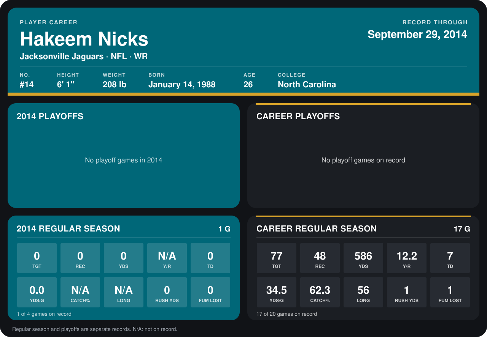

# Hakeem Nicks

## Career stats

### Regular season

| Season | Team | Age | # | G | TGT | REC | YDS | Y/R | TD | YDS/G | CATCH% | LONG | RUSH YDS | FUM LOST |
|---|---|---:|---:|---:|---:|---:|---:|---:|---:|---:|---:|---:|---:|---:|
| 2013 | New York Giants | 25 | 88 | 16 | 77 | 48 | 586 | 12.2 | 7 | 36.6 | 62.3 | 56 | 1 | 1 |
| 2014 | Jacksonville Jaguars | 26 | 14 | 2 | 0 | 0 | 0 | N/A | 0 | 0.0 | N/A | N/A | 0 | 0 |
| **Career** |  |  |  | 18 | 77 | 48 | 586 | 12.2 | 7 | 32.6 | 62.3 | 56 | 1 | 1 |

### Playoffs

No playoff games on record.

## Awards

None on record.

[Jacksonville player card](../../2014/Team_Operations/Team/Player_Cards/hakeem_nicks.md)

Age is his age on the league's opening game of each season; # is the number listed for him that season with that team (2014: the card's rule; 2013: the 2013 season roster), N/A where no listing applies.

Records through October 5, 2014. Identity: listed 2014 roster data, Weeks 1-4; number: the number he wore in 2014 with the Indianapolis Colts (Jacksonville has not recorded one). [All Jacksonville Jaguars players](README.md).
