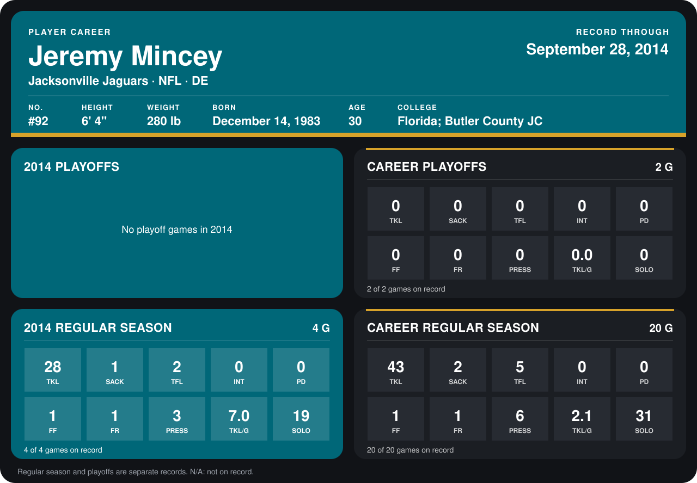

# Jeremy Mincey

## Career stats

### Regular season

| Season | Club | G | TKL | SACK | TFL | INT | PD | FF | FR | PRESS | TKL/G | SOLO |
|---|---|---:|---:|---:|---:|---:|---:|---:|---:|---:|---:|---:|
| 2013 | Jacksonville Jaguars | 16 | 15 | 1 | 3 | 0 | 0 | 0 | 0 | 3 | 0.9 | 12 |
| 2014 | Jacksonville Jaguars | 4 | 28 | 1 | 2 | 0 | 0 | 1 | 1 | 3 | 7.0 | 19 |
| **Career** |  | 20 | 43 | 2 | 5 | 0 | 0 | 1 | 1 | 6 | 2.1 | 31 |

### Playoffs

| Season | Club | G | TKL | SACK | TFL | INT | PD | FF | FR | PRESS | TKL/G | SOLO |
|---|---|---:|---:|---:|---:|---:|---:|---:|---:|---:|---:|---:|
| 2013 | Jacksonville Jaguars | 2 | 0 | 0 | 0 | 0 | 0 | 0 | 0 | 0 | 0.0 | 0 |
| **Career** |  | 2 | 0 | 0 | 0 | 0 | 0 | 0 | 0 | 0 | 0.0 | 0 |

## Awards

None on record.

[Jacksonville player card](../../2014/00_Team_Operations/Team/Player_Cards/jeremy_mincey.md)

Records through September 28, 2014. Identity: listed 2014 roster data, Weeks 1-4; number: the number he wore in 2014 with the Dallas Cowboys (Jacksonville has not recorded one). [All Jacksonville Jaguars players](README.md).
