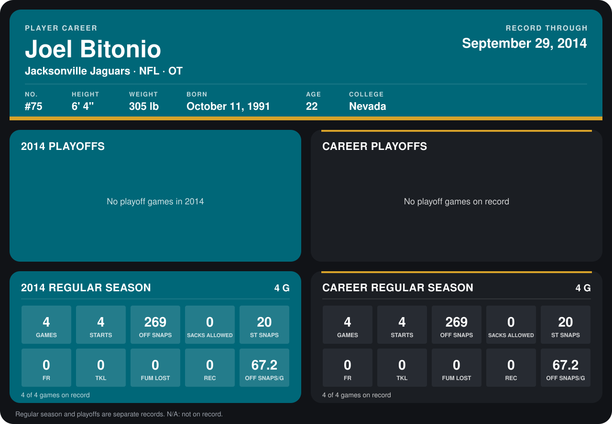

# Joel Bitonio

## Career stats

### Regular season

| Season | Club | G | STARTS | OFF SNAPS | SACKS ALLOWED | ST SNAPS | FR | TKL | FUM LOST | REC | OFF SNAPS/G |
|---|---|---:|---:|---:|---:|---:|---:|---:|---:|---:|---:|
| 2014 | Jacksonville Jaguars | 4 | 4 | 269 | 0 | 20 | 0 | 0 | 0 | 0 | 67.2 |
| **Career** |  | 4 | 4 | 269 | 0 | 20 | 0 | 0 | 0 | 0 | 67.2 |

### Playoffs

No playoff games on record.

## Awards

None on record.

[Jacksonville player card](../../2014/00_Team_Operations/Team/Player_Cards/joel_bitonio.md)

Records through September 29, 2014. Identity: listed 2014 roster data, Weeks 1-4; number: the number he wore in 2014 with the Cleveland Browns (Jacksonville has not recorded one). [All Jacksonville Jaguars players](README.md).
