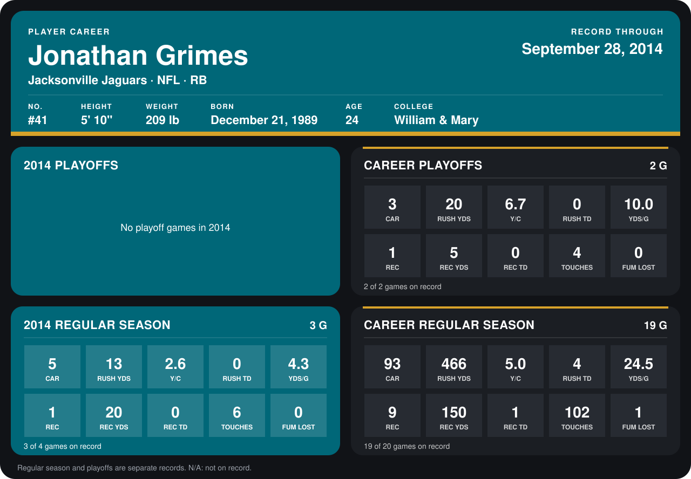

# Jonathan Grimes

## Career stats

### Regular season

| Season | Club | G | CAR | RUSH YDS | Y/C | RUSH TD | YDS/G | REC | REC YDS | REC TD | TOUCHES | FUM LOST |
|---|---|---:|---:|---:|---:|---:|---:|---:|---:|---:|---:|---:|
| 2013 | Jacksonville Jaguars | 16 | 88 | 453 | 5.1 | 4 | 28.3 | 8 | 130 | 1 | 96 | 1 |
| 2014 | Jacksonville Jaguars | 3 | 5 | 13 | 2.6 | 0 | 4.3 | 1 | 20 | 0 | 6 | 0 |
| **Career** |  | 19 | 93 | 466 | 5.0 | 4 | 24.5 | 9 | 150 | 1 | 102 | 1 |

### Playoffs

| Season | Club | G | CAR | RUSH YDS | Y/C | RUSH TD | YDS/G | REC | REC YDS | REC TD | TOUCHES | FUM LOST |
|---|---|---:|---:|---:|---:|---:|---:|---:|---:|---:|---:|---:|
| 2013 | Jacksonville Jaguars | 2 | 3 | 20 | 6.7 | 0 | 10.0 | 1 | 5 | 0 | 4 | 0 |
| **Career** |  | 2 | 3 | 20 | 6.7 | 0 | 10.0 | 1 | 5 | 0 | 4 | 0 |

## Awards

None on record.

[Jacksonville player card](../../2014/00_Team_Operations/Team/Player_Cards/jonathan_grimes.md)

Records through September 28, 2014. Identity: listed 2014 roster data, Weeks 1-4; number: the number he wore in 2014 with the Houston Texans (Jacksonville has not recorded one). [All Jacksonville Jaguars players](README.md).
