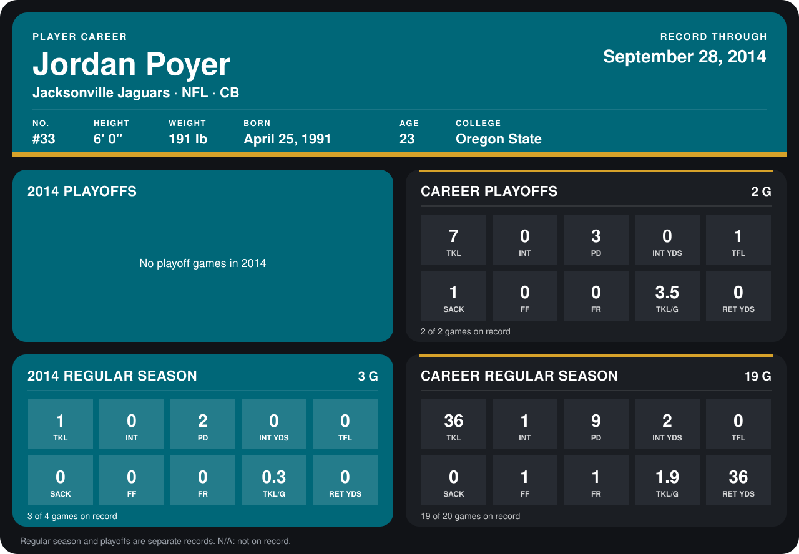

# Jordan Poyer

## Career stats

### Regular season

| Season | Team | Age | # | G | TKL | INT | PD | INT YDS | TFL | SACK | FF | FR | TKL/G | RET YDS |
|---|---|---:|---:|---:|---:|---:|---:|---:|---:|---:|---:|---:|---:|---:|
| 2013 | Jacksonville Jaguars | 22 | N/A | 16 | 35 | 1 | 7 | 2 | 0 | 0 | 1 | 1 | 2.2 | 36 |
| 2014 | Jacksonville Jaguars | 23 | 33 | 3 | 1 | 0 | 2 | 0 | 0 | 0 | 0 | 0 | 0.3 | 0 |
| **Career** |  |  |  | 19 | 36 | 1 | 9 | 2 | 0 | 0 | 1 | 1 | 1.9 | 36 |

### Playoffs

| Season | Team | Age | # | G | TKL | INT | PD | INT YDS | TFL | SACK | FF | FR | TKL/G | RET YDS |
|---|---|---:|---:|---:|---:|---:|---:|---:|---:|---:|---:|---:|---:|---:|
| 2013 | Jacksonville Jaguars | 22 | N/A | 2 | 7 | 0 | 3 | 0 | 1 | 1 | 0 | 0 | 3.5 | 0 |
| **Career** |  |  |  | 2 | 7 | 0 | 3 | 0 | 1 | 1 | 0 | 0 | 3.5 | 0 |

## Awards

None on record.

[Jacksonville player card](../../2014/00_Team_Operations/Team/Player_Cards/jordan_poyer.md)

Age is his age on the league's opening game of each season; # is the number listed for him that season with that team (2014: the card's rule; 2013: the 2013 season roster), N/A where no listing applies.

Records through September 28, 2014. Identity: listed 2014 roster data, Weeks 1-4; number: the number he wore in 2014 with the Cleveland Browns (Jacksonville has not recorded one). [All Jacksonville Jaguars players](README.md).
