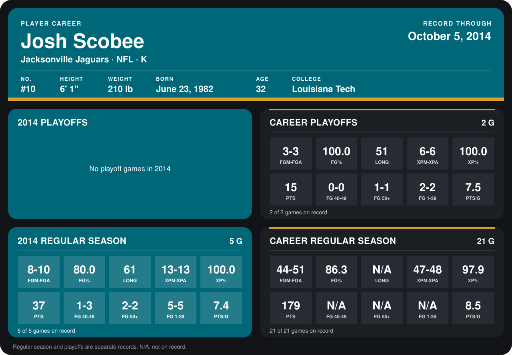

# Josh Scobee

## Career stats

### Regular season

| Season | Club | G | FGM-FGA | FG% | LONG | XPM-XPA | XP% | PTS | FG 40-49 | FG 50+ | FG 1-39 | PTS/G |
|---|---|---:|---:|---:|---:|---:|---:|---:|---:|---:|---:|---:|
| 2013 | Jacksonville Jaguars | 16 | 36-41 | 87.8 | N/A | 34-35 | 97.1 | 142 | N/A | N/A | N/A | 8.9 |
| 2014 | Jacksonville Jaguars | 4 | 7-8 | 87.5 | 61 | 12-12 | 100.0 | 33 | 1-2 | 2-2 | 4-4 | 8.2 |
| **Career** |  | 20 | 43-49 | 87.8 | N/A | 46-47 | 97.9 | 175 | N/A | N/A | N/A | 8.8 |

### Playoffs

| Season | Club | G | FGM-FGA | FG% | LONG | XPM-XPA | XP% | PTS | FG 40-49 | FG 50+ | FG 1-39 | PTS/G |
|---|---|---:|---:|---:|---:|---:|---:|---:|---:|---:|---:|---:|
| 2013 | Jacksonville Jaguars | 2 | 3-3 | 100.0 | 51 | 6-6 | 100.0 | 15 | 0-0 | 1-1 | 2-2 | 7.5 |
| **Career** |  | 2 | 3-3 | 100.0 | 51 | 6-6 | 100.0 | 15 | 0-0 | 1-1 | 2-2 | 7.5 |

## Awards

None on record.

[Jacksonville player card](../../2014/00_Team_Operations/Team/Player_Cards/josh_scobee.md)

Records through September 29, 2014. Identity: listed 2014 roster data, Weeks 1-4; number: his 2014 Jaguars roster listing. [All Jacksonville Jaguars players](README.md).
