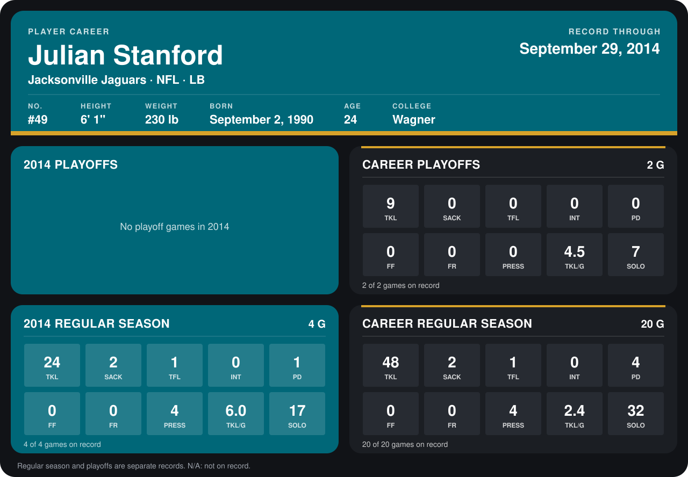

# Julian Stanford

## Career stats

### Regular season

| Season | Club | G | TKL | SACK | TFL | INT | PD | FF | FR | PRESS | TKL/G | SOLO |
|---|---|---:|---:|---:|---:|---:|---:|---:|---:|---:|---:|---:|
| 2013 | Jacksonville Jaguars | 16 | 24 | 0 | 0 | 0 | 3 | 0 | 0 | 0 | 1.5 | 15 |
| 2014 | Jacksonville Jaguars | 5 | 25 | 2 | 1 | 0 | 1 | 0 | 0 | 4 | 5.0 | 18 |
| **Career** |  | 21 | 49 | 2 | 1 | 0 | 4 | 0 | 0 | 4 | 2.3 | 33 |

### Playoffs

| Season | Club | G | TKL | SACK | TFL | INT | PD | FF | FR | PRESS | TKL/G | SOLO |
|---|---|---:|---:|---:|---:|---:|---:|---:|---:|---:|---:|---:|
| 2013 | Jacksonville Jaguars | 2 | 9 | 0 | 0 | 0 | 0 | 0 | 0 | 0 | 4.5 | 7 |
| **Career** |  | 2 | 9 | 0 | 0 | 0 | 0 | 0 | 0 | 0 | 4.5 | 7 |

## Awards

None on record.

[Jacksonville player card](../../2014/00_Team_Operations/Team/Player_Cards/julian_stanford.md)

Records through October 5, 2014. Identity: listed 2014 roster data, Weeks 1-4; number: the number he wore in 2014 with the Detroit Lions (Jacksonville has not recorded one). [All Jacksonville Jaguars players](README.md).
