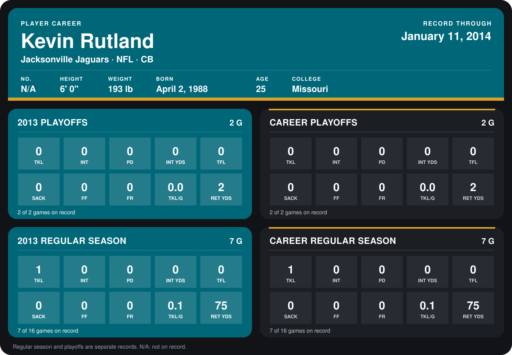

# Kevin Rutland

## Career stats

### Regular season

| Season | Team | Age | # | G | TKL | INT | PD | INT YDS | TFL | SACK | FF | FR | TKL/G | RET YDS |
|---|---|---:|---:|---:|---:|---:|---:|---:|---:|---:|---:|---:|---:|---:|
| 2013 | Jacksonville Jaguars | 25 | N/A | 7 | 1 | 0 | 0 | 0 | 0 | 0 | 0 | 0 | 0.1 | 75 |
| **Career** |  |  |  | 7 | 1 | 0 | 0 | 0 | 0 | 0 | 0 | 0 | 0.1 | 75 |

### Playoffs

| Season | Team | Age | # | G | TKL | INT | PD | INT YDS | TFL | SACK | FF | FR | TKL/G | RET YDS |
|---|---|---:|---:|---:|---:|---:|---:|---:|---:|---:|---:|---:|---:|---:|
| 2013 | Jacksonville Jaguars | 25 | N/A | 2 | 0 | 0 | 0 | 0 | 0 | 0 | 0 | 0 | 0.0 | 2 |
| **Career** |  |  |  | 2 | 0 | 0 | 0 | 0 | 0 | 0 | 0 | 0 | 0.0 | 2 |

## Awards

None on record.

Age is his age on the league's opening game of each season; # is the number listed for him that season with that team (2014: the card's rule; 2013: the 2013 season roster), N/A where no listing applies.

Records through January 11, 2014. Identity: the public player file, last listed in 2013 or earlier (no 2014 Weeks 1-4 or 2013 roster row). [All Jacksonville Jaguars players](README.md).
