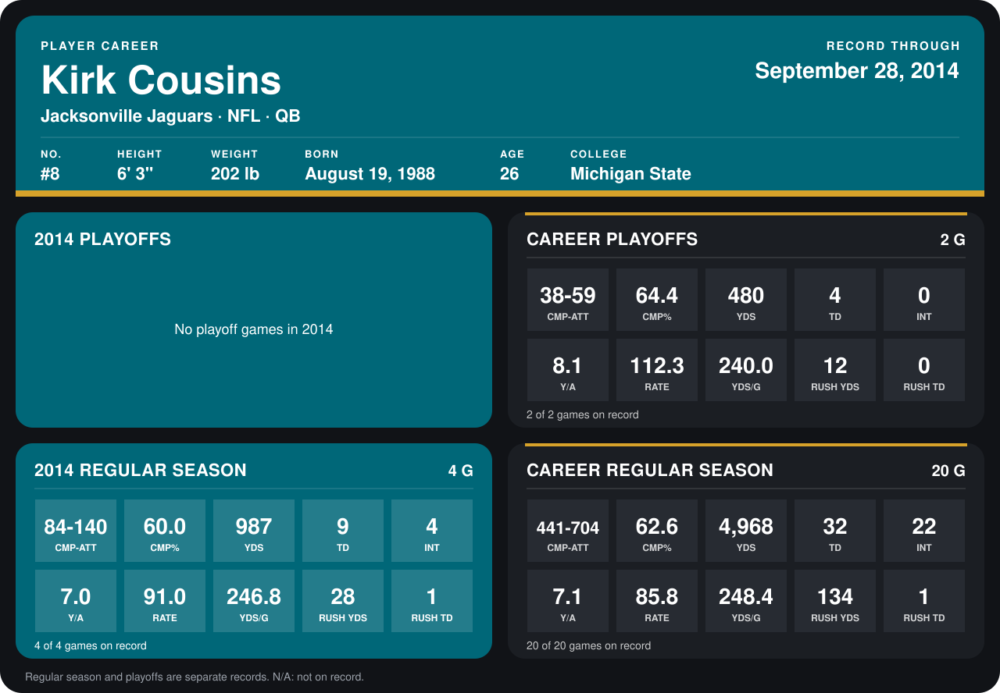

# Kirk Cousins

## Career stats

### Regular season

| Season | Club | G | CMP-ATT | CMP% | YDS | TD | INT | Y/A | RATE | YDS/G | RUSH YDS | RUSH TD |
|---|---|---:|---:|---:|---:|---:|---:|---:|---:|---:|---:|---:|
| 2013 | Jacksonville Jaguars | 16 | 357-564 | 63.3 | 3,981 | 23 | 18 | 7.1 | 84.5 | 248.8 | 106 | 0 |
| 2014 | Jacksonville Jaguars | 4 | 84-140 | 60.0 | 987 | 9 | 4 | 7.0 | 91.0 | 246.8 | 28 | 1 |
| **Career** |  | 20 | 441-704 | 62.6 | 4,968 | 32 | 22 | 7.1 | 85.8 | 248.4 | 134 | 1 |

### Playoffs

| Season | Club | G | CMP-ATT | CMP% | YDS | TD | INT | Y/A | RATE | YDS/G | RUSH YDS | RUSH TD |
|---|---|---:|---:|---:|---:|---:|---:|---:|---:|---:|---:|---:|
| 2013 | Jacksonville Jaguars | 2 | 38-59 | 64.4 | 480 | 4 | 0 | 8.1 | 112.3 | 240.0 | 12 | 0 |
| **Career** |  | 2 | 38-59 | 64.4 | 480 | 4 | 0 | 8.1 | 112.3 | 240.0 | 12 | 0 |

## Awards

None on record.

[Jacksonville player card](../../2014/00_Team_Operations/Team/Player_Cards/kirk_cousins.md)

Records through September 29, 2014. Identity: listed 2014 roster data, Weeks 1-4; number: the number he wore in 2014 with the Washington Redskins (Jacksonville has not recorded one). [All Jacksonville Jaguars players](README.md).
