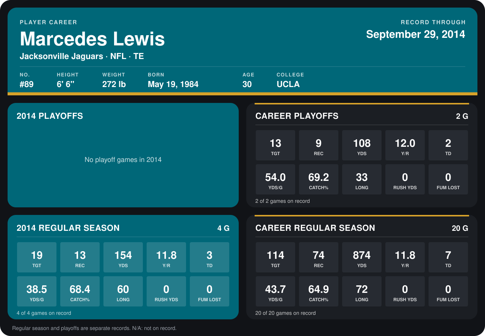

# Marcedes Lewis

## Career stats

### Regular season

| Season | Team | Age | # | G | TGT | REC | YDS | Y/R | TD | YDS/G | CATCH% | LONG | RUSH YDS | FUM LOST |
|---|---|---:|---:|---:|---:|---:|---:|---:|---:|---:|---:|---:|---:|---:|
| 2013 | Jacksonville Jaguars | 29 | 89 | 16 | 95 | 61 | 720 | 11.8 | 4 | 45.0 | 64.2 | 72 | 0 | 0 |
| 2014 | Jacksonville Jaguars | 30 | 89 | 4 | 19 | 13 | 154 | 11.8 | 3 | 38.5 | 68.4 | 60 | 0 | 0 |
| **Career** |  |  |  | 20 | 114 | 74 | 874 | 11.8 | 7 | 43.7 | 64.9 | 72 | 0 | 0 |

### Playoffs

| Season | Team | Age | # | G | TGT | REC | YDS | Y/R | TD | YDS/G | CATCH% | LONG | RUSH YDS | FUM LOST |
|---|---|---:|---:|---:|---:|---:|---:|---:|---:|---:|---:|---:|---:|---:|
| 2013 | Jacksonville Jaguars | 29 | 89 | 2 | 13 | 9 | 108 | 12.0 | 2 | 54.0 | 69.2 | 33 | 0 | 0 |
| **Career** |  |  |  | 2 | 13 | 9 | 108 | 12.0 | 2 | 54.0 | 69.2 | 33 | 0 | 0 |

## Awards

- Pro Bowl selection, replacement (2013, TE)

[Jacksonville player card](../../2014/00_Team_Operations/Team/Player_Cards/marcedes_lewis.md)

Age is his age on the league's opening game of each season; # is the number listed for him that season with that team (2014: the card's rule; 2013: the 2013 season roster), N/A where no listing applies.

Records through September 28, 2014. Identity: listed 2014 roster data, Weeks 1-4; number: his 2014 Jaguars roster listing. [All Jacksonville Jaguars players](README.md).
