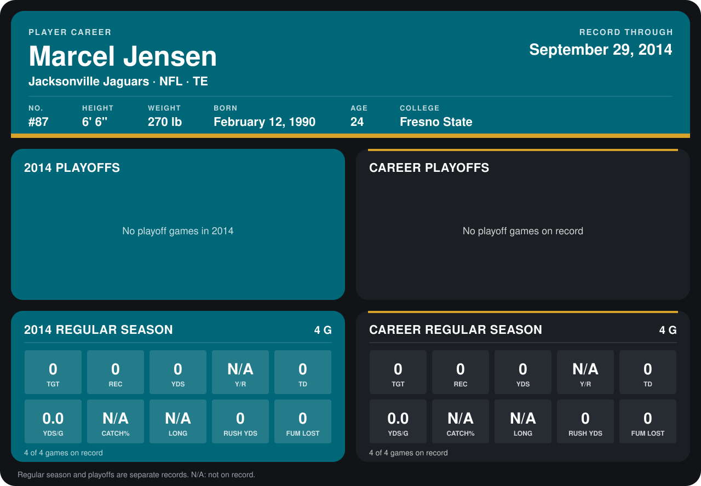

# Marcel Jensen

## Career stats

### Regular season

| Season | Team | Age | # | G | TGT | REC | YDS | Y/R | TD | YDS/G | CATCH% | LONG | RUSH YDS | FUM LOST |
|---|---|---:|---:|---:|---:|---:|---:|---:|---:|---:|---:|---:|---:|---:|
| 2014 | Jacksonville Jaguars | 24 | 87 | 5 | 1 | 1 | 10 | 10.0 | 0 | 2.0 | 100.0 | 10 | 0 | 0 |
| **Career** |  |  |  | 5 | 1 | 1 | 10 | 10.0 | 0 | 2.0 | 100.0 | 10 | 0 | 0 |

### Playoffs

No playoff games on record.

## Awards

None on record.

[Jacksonville player card](../../2014/Team_Operations/Team/Player_Cards/marcel_jensen.md)

Age is his age on the league's opening game of each season; # is the number listed for him that season with that team (2014: the card's rule; 2013: the 2013 season roster), N/A where no listing applies.

Records through October 5, 2014. Identity: listed 2014 roster data, Weeks 1-4; number: his 2014 Jaguars roster listing. [All Jacksonville Jaguars players](README.md).
