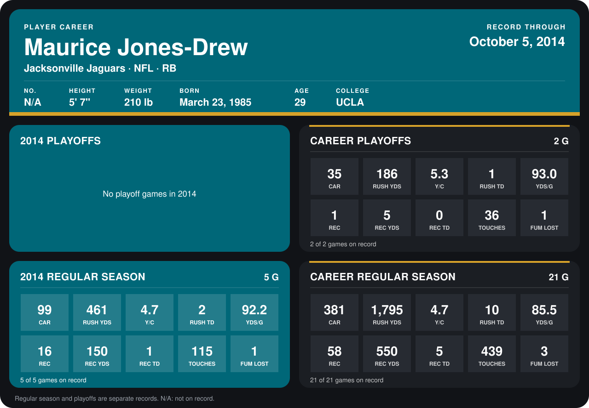

# Maurice Jones-Drew

## Career stats

### Regular season

| Season | Club | G | CAR | RUSH YDS | Y/C | RUSH TD | YDS/G | REC | REC YDS | REC TD | TOUCHES | FUM LOST |
|---|---|---:|---:|---:|---:|---:|---:|---:|---:|---:|---:|---:|
| 2013 | Jacksonville Jaguars | 16 | 282 | 1,334 | 4.7 | 8 | 83.4 | 42 | 400 | 4 | 324 | 2 |
| 2014 | Jacksonville Jaguars | 4 | 75 | 351 | 4.7 | 1 | 87.8 | 11 | 94 | 1 | 86 | 0 |
| **Career** |  | 20 | 357 | 1,685 | 4.7 | 9 | 84.2 | 53 | 494 | 5 | 410 | 2 |

### Playoffs

| Season | Club | G | CAR | RUSH YDS | Y/C | RUSH TD | YDS/G | REC | REC YDS | REC TD | TOUCHES | FUM LOST |
|---|---|---:|---:|---:|---:|---:|---:|---:|---:|---:|---:|---:|
| 2013 | Jacksonville Jaguars | 2 | 35 | 186 | 5.3 | 1 | 93.0 | 1 | 5 | 0 | 36 | 1 |
| **Career** |  | 2 | 35 | 186 | 5.3 | 1 | 93.0 | 1 | 5 | 0 | 36 | 1 |

## Awards

- AP Comeback Player of the Year (2013)

[Jacksonville player card](../../2014/00_Team_Operations/Team/Player_Cards/maurice_jones_drew.md)

Records through September 29, 2014. Identity: listed 2014 roster data, Weeks 1-4. [All Jacksonville Jaguars players](README.md).
