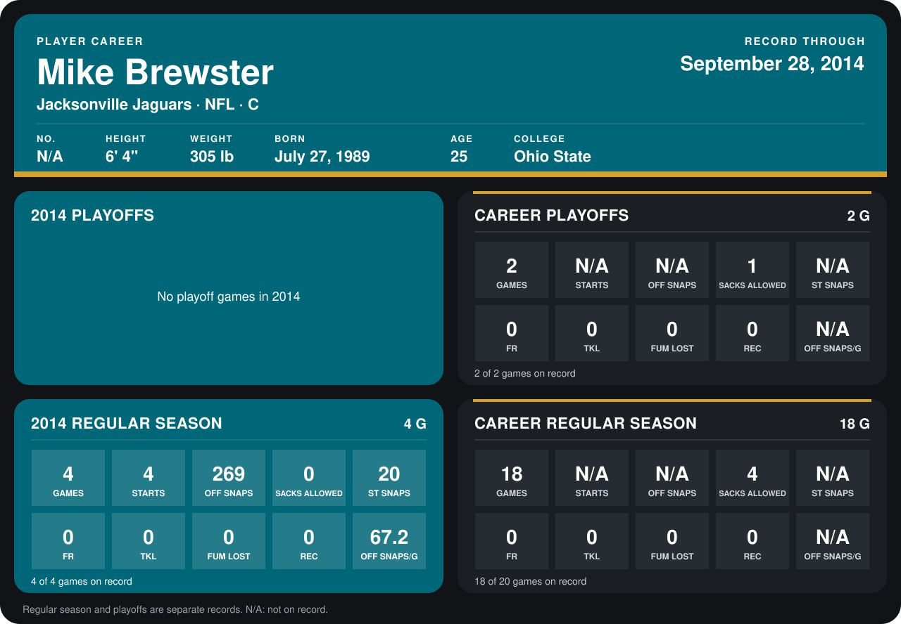

# Mike Brewster

## Career stats

### Regular season

| Season | Team | Age | # | G | STARTS | OFF SNAPS | SACKS ALLOWED | ST SNAPS | FR | TKL | FUM LOST | REC | OFF SNAPS/G |
|---|---|---:|---:|---:|---:|---:|---:|---:|---:|---:|---:|---:|---:|
| 2013 | Jacksonville Jaguars | 24 | 60 | 14 | N/A | N/A | 4 | N/A | 0 | 0 | 0 | 0 | N/A |
| 2014 | Jacksonville Jaguars | 25 | N/A | 4 | 4 | 269 | 0 | 20 | 0 | 0 | 0 | 0 | 67.2 |
| **Career** |  |  |  | 18 | N/A | N/A | 4 | N/A | 0 | 0 | 0 | 0 | N/A |

### Playoffs

| Season | Team | Age | # | G | STARTS | OFF SNAPS | SACKS ALLOWED | ST SNAPS | FR | TKL | FUM LOST | REC | OFF SNAPS/G |
|---|---|---:|---:|---:|---:|---:|---:|---:|---:|---:|---:|---:|---:|
| 2013 | Jacksonville Jaguars | 24 | 60 | 2 | N/A | N/A | 1 | N/A | 0 | 0 | 0 | 0 | N/A |
| **Career** |  |  |  | 2 | N/A | N/A | 1 | N/A | 0 | 0 | 0 | 0 | N/A |

## Awards

None on record.

[Jacksonville player card](../../2014/00_Team_Operations/Team/Player_Cards/mike_brewster.md)

Age is his age on the league's opening game of each season; # is the number listed for him that season with that team (2014: the card's rule; 2013: the 2013 season roster), N/A where no listing applies.

Records through September 28, 2014. Identity: his listed 2013 season roster data (no 2014 Weeks 1-4 roster row). [All Jacksonville Jaguars players](README.md).
