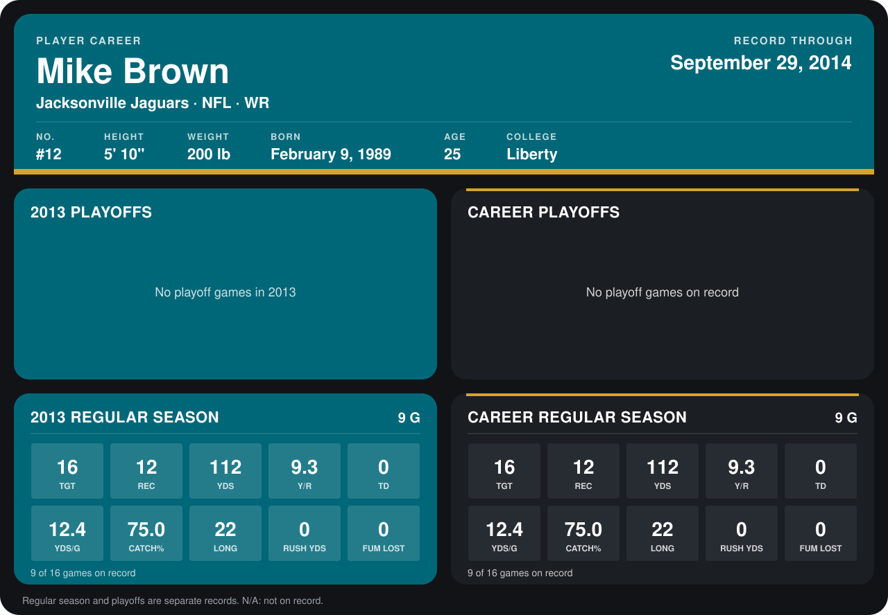

# Mike Brown

## Career stats

### Regular season

| Season | Club | G | TGT | REC | YDS | Y/R | TD | YDS/G | CATCH% | LONG | RUSH YDS | FUM LOST |
|---|---|---:|---:|---:|---:|---:|---:|---:|---:|---:|---:|---:|
| 2013 | Jacksonville Jaguars | 9 | 16 | 12 | 112 | 9.3 | 0 | 12.4 | 75.0 | 22 | 0 | 0 |
| **Career** |  | 9 | 16 | 12 | 112 | 9.3 | 0 | 12.4 | 75.0 | 22 | 0 | 0 |

### Playoffs

No playoff games on record.

## Awards

None on record.

Records through September 29, 2014. Identity: listed 2014 roster data, Weeks 1-4; number: his 2014 Jaguars roster listing. [All Jacksonville Jaguars players](README.md).
