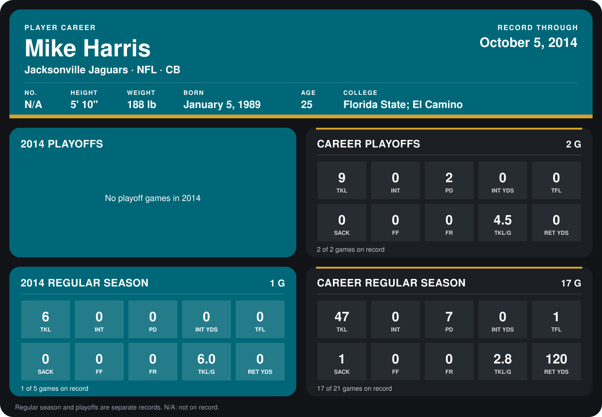

# Mike Harris

## Career stats

### Regular season

| Season | Team | Age | # | G | TKL | INT | PD | INT YDS | TFL | SACK | FF | FR | TKL/G | RET YDS |
|---|---|---:|---:|---:|---:|---:|---:|---:|---:|---:|---:|---:|---:|---:|
| 2013 | Jacksonville Jaguars | 24 | 20 | 16 | 41 | 0 | 7 | 0 | 1 | 1 | 0 | 0 | 2.6 | 120 |
| 2014 | Jacksonville Jaguars | 25 | N/A | 1 | 6 | 0 | 0 | 0 | 0 | 0 | 0 | 0 | 6.0 | 0 |
| **Career** |  |  |  | 17 | 47 | 0 | 7 | 0 | 1 | 1 | 0 | 0 | 2.8 | 120 |

### Playoffs

| Season | Team | Age | # | G | TKL | INT | PD | INT YDS | TFL | SACK | FF | FR | TKL/G | RET YDS |
|---|---|---:|---:|---:|---:|---:|---:|---:|---:|---:|---:|---:|---:|---:|
| 2013 | Jacksonville Jaguars | 24 | 20 | 2 | 9 | 0 | 2 | 0 | 0 | 0 | 0 | 0 | 4.5 | 0 |
| **Career** |  |  |  | 2 | 9 | 0 | 2 | 0 | 0 | 0 | 0 | 0 | 4.5 | 0 |

## Awards

None on record.

[Jacksonville player card](../../2014/00_Team_Operations/Team/Player_Cards/mike_harris.md)

Age is his age on the league's opening game of each season; # is the number listed for him that season with that team (2014: the card's rule; 2013: the 2013 season roster), N/A where no listing applies.

Records through September 28, 2014. Identity: his listed 2013 season roster data (no 2014 Weeks 1-4 roster row). [All Jacksonville Jaguars players](README.md).
