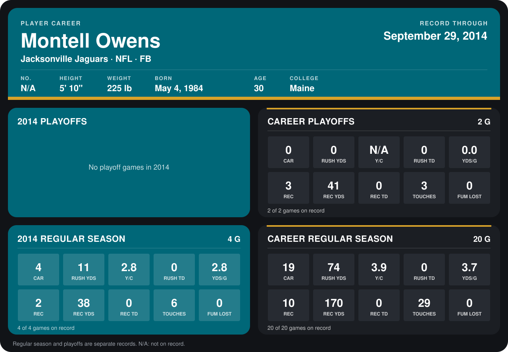

# Montell Owens

## Career stats

### Regular season

| Season | Team | Age | # | G | CAR | RUSH YDS | Y/C | RUSH TD | YDS/G | REC | REC YDS | REC TD | TOUCHES | FUM LOST |
|---|---|---:|---:|---:|---:|---:|---:|---:|---:|---:|---:|---:|---:|---:|
| 2013 | Jacksonville Jaguars | 29 | N/A | 16 | 15 | 63 | 4.2 | 0 | 3.9 | 8 | 132 | 0 | 23 | 0 |
| 2014 | Jacksonville Jaguars | 30 | N/A | 4 | 4 | 11 | 2.8 | 0 | 2.8 | 2 | 38 | 0 | 6 | 0 |
| **Career** |  |  |  | 20 | 19 | 74 | 3.9 | 0 | 3.7 | 10 | 170 | 0 | 29 | 0 |

### Playoffs

| Season | Team | Age | # | G | CAR | RUSH YDS | Y/C | RUSH TD | YDS/G | REC | REC YDS | REC TD | TOUCHES | FUM LOST |
|---|---|---:|---:|---:|---:|---:|---:|---:|---:|---:|---:|---:|---:|---:|
| 2013 | Jacksonville Jaguars | 29 | N/A | 2 | 0 | 0 | N/A | 0 | 0.0 | 3 | 41 | 0 | 3 | 0 |
| **Career** |  |  |  | 2 | 0 | 0 | N/A | 0 | 0.0 | 3 | 41 | 0 | 3 | 0 |

## Awards

None on record.

[Jacksonville player card](../../2014/00_Team_Operations/Team/Player_Cards/montell_owens.md)

Age is his age on the league's opening game of each season; # is the number listed for him that season with that team (2014: the card's rule; 2013: the 2013 season roster), N/A where no listing applies.

Records through September 28, 2014. Identity: listed 2014 roster data, Weeks 1-4. [All Jacksonville Jaguars players](README.md).
