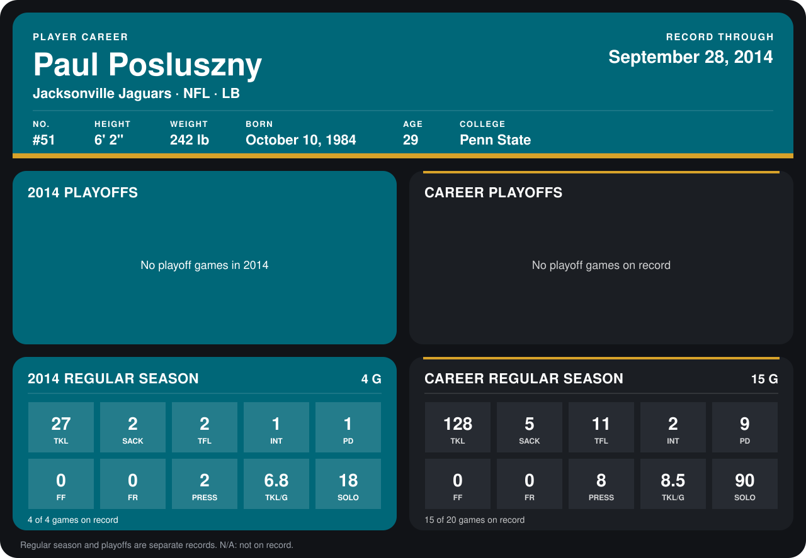

# Paul Posluszny

## Career stats

### Regular season

| Season | Team | Age | # | G | TKL | SACK | TFL | INT | PD | FF | FR | PRESS | TKL/G | SOLO |
|---|---|---:|---:|---:|---:|---:|---:|---:|---:|---:|---:|---:|---:|---:|
| 2013 | Jacksonville Jaguars | 28 | 51 | 11 | 101 | 3 | 9 | 1 | 8 | 0 | 0 | 6 | 9.2 | 72 |
| 2014 | Jacksonville Jaguars | 29 | 51 | 5 | 31 | 2 | 2 | 1 | 1 | 0 | 0 | 2 | 6.2 | 20 |
| **Career** |  |  |  | 16 | 132 | 5 | 11 | 2 | 9 | 0 | 0 | 8 | 8.2 | 92 |

### Playoffs

No playoff games on record.

## Awards

None on record.

[Jacksonville player card](../../2014/Team_Operations/Team/Player_Cards/paul_posluszny.md)

Age is his age on the league's opening game of each season; # is the number listed for him that season with that team (2014: the card's rule; 2013: the 2013 season roster), N/A where no listing applies.

Records through October 5, 2014. Identity: listed 2014 roster data, Weeks 1-4; number: his 2014 Jaguars roster listing. [All Jacksonville Jaguars players](README.md).
