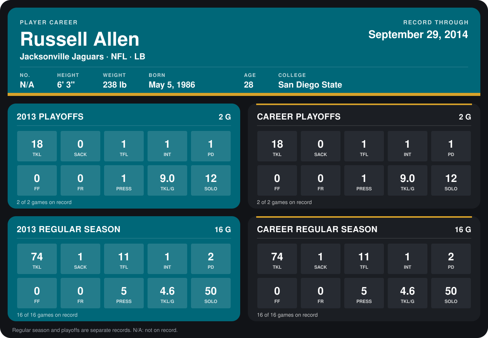

# Russell Allen

## Career stats

### Regular season

| Season | Team | Age | # | G | TKL | SACK | TFL | INT | PD | FF | FR | PRESS | TKL/G | SOLO |
|---|---|---:|---:|---:|---:|---:|---:|---:|---:|---:|---:|---:|---:|---:|
| 2013 | Jacksonville Jaguars | 27 | 50 | 16 | 74 | 1 | 11 | 1 | 2 | 0 | 0 | 5 | 4.6 | 50 |
| **Career** |  |  |  | 16 | 74 | 1 | 11 | 1 | 2 | 0 | 0 | 5 | 4.6 | 50 |

### Playoffs

| Season | Team | Age | # | G | TKL | SACK | TFL | INT | PD | FF | FR | PRESS | TKL/G | SOLO |
|---|---|---:|---:|---:|---:|---:|---:|---:|---:|---:|---:|---:|---:|---:|
| 2013 | Jacksonville Jaguars | 27 | 50 | 2 | 18 | 0 | 1 | 1 | 1 | 0 | 0 | 1 | 9.0 | 12 |
| **Career** |  |  |  | 2 | 18 | 0 | 1 | 1 | 1 | 0 | 0 | 1 | 9.0 | 12 |

## Awards

None on record.

Age is his age on the league's opening game of each season; # is the number listed for him that season with that team (2014: the card's rule; 2013: the 2013 season roster), N/A where no listing applies.

Records through January 11, 2014. Identity: his listed 2013 season roster data (no 2014 Weeks 1-4 roster row). [All Jacksonville Jaguars players](README.md).
