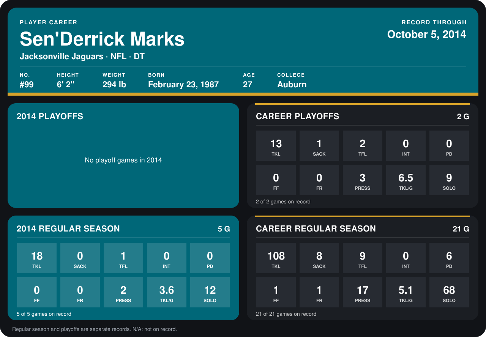

# Sen'Derrick Marks

## Career stats

### Regular season

| Season | Team | Age | # | G | TKL | SACK | TFL | INT | PD | FF | FR | PRESS | TKL/G | SOLO |
|---|---|---:|---:|---:|---:|---:|---:|---:|---:|---:|---:|---:|---:|---:|
| 2013 | Jacksonville Jaguars | 26 | 99 | 16 | 90 | 8 | 8 | 0 | 6 | 1 | 1 | 15 | 5.6 | 56 |
| 2014 | Jacksonville Jaguars | 27 | 99 | 5 | 18 | 0 | 1 | 0 | 0 | 0 | 0 | 2 | 3.6 | 12 |
| **Career** |  |  |  | 21 | 108 | 8 | 9 | 0 | 6 | 1 | 1 | 17 | 5.1 | 68 |

### Playoffs

| Season | Team | Age | # | G | TKL | SACK | TFL | INT | PD | FF | FR | PRESS | TKL/G | SOLO |
|---|---|---:|---:|---:|---:|---:|---:|---:|---:|---:|---:|---:|---:|---:|
| 2013 | Jacksonville Jaguars | 26 | 99 | 2 | 13 | 1 | 2 | 0 | 0 | 0 | 0 | 3 | 6.5 | 9 |
| **Career** |  |  |  | 2 | 13 | 1 | 2 | 0 | 0 | 0 | 0 | 3 | 6.5 | 9 |

## Awards

None on record.

[Jacksonville player card](../../2014/Team_Operations/Team/Player_Cards/sen_derrick_marks.md)

Age is his age on the league's opening game of each season; # is the number listed for him that season with that team (2014: the card's rule; 2013: the 2013 season roster), N/A where no listing applies.

Records through October 5, 2014. Identity: listed 2014 roster data, Weeks 1-4; number: his 2014 Jaguars roster listing. [All Jacksonville Jaguars players](README.md).
