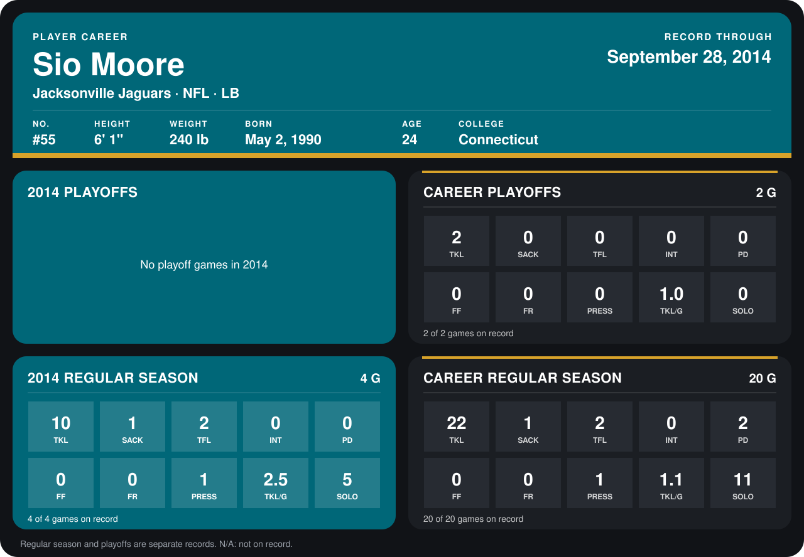

# Sio Moore

## Career stats

### Regular season

| Season | Team | Age | # | G | TKL | SACK | TFL | INT | PD | FF | FR | PRESS | TKL/G | SOLO |
|---|---|---:|---:|---:|---:|---:|---:|---:|---:|---:|---:|---:|---:|---:|
| 2013 | Jacksonville Jaguars | 23 | N/A | 16 | 12 | 0 | 0 | 0 | 2 | 0 | 0 | 0 | 0.8 | 6 |
| 2014 | Jacksonville Jaguars | 24 | 55 | 4 | 10 | 1 | 2 | 0 | 0 | 0 | 0 | 1 | 2.5 | 5 |
| **Career** |  |  |  | 20 | 22 | 1 | 2 | 0 | 2 | 0 | 0 | 1 | 1.1 | 11 |

### Playoffs

| Season | Team | Age | # | G | TKL | SACK | TFL | INT | PD | FF | FR | PRESS | TKL/G | SOLO |
|---|---|---:|---:|---:|---:|---:|---:|---:|---:|---:|---:|---:|---:|---:|
| 2013 | Jacksonville Jaguars | 23 | N/A | 2 | 2 | 0 | 0 | 0 | 0 | 0 | 0 | 0 | 1.0 | 0 |
| **Career** |  |  |  | 2 | 2 | 0 | 0 | 0 | 0 | 0 | 0 | 0 | 1.0 | 0 |

## Awards

None on record.

[Jacksonville player card](../../2014/00_Team_Operations/Team/Player_Cards/sio_moore.md)

Age is his age on the league's opening game of each season; # is the number listed for him that season with that team (2014: the card's rule; 2013: the 2013 season roster), N/A where no listing applies.

Records through September 28, 2014. Identity: listed 2014 roster data, Weeks 1-4; number: the number he wore in 2014 with the Oakland Raiders (Jacksonville has not recorded one). [All Jacksonville Jaguars players](README.md).
