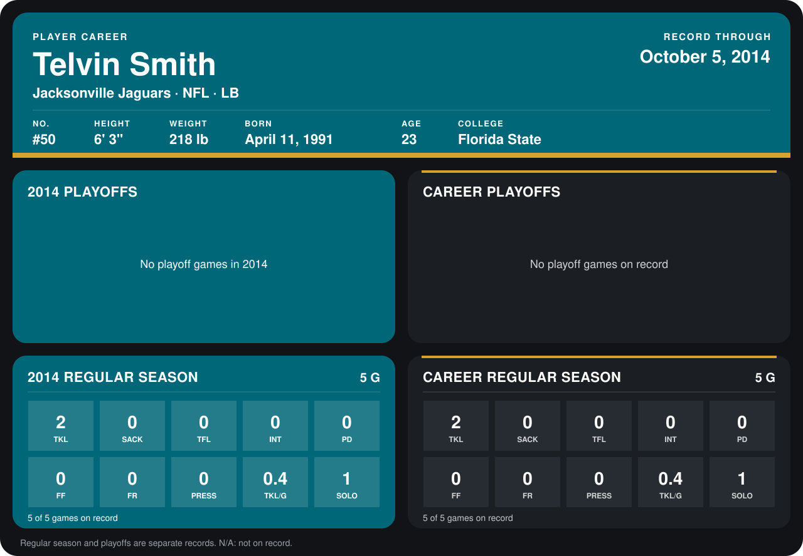

# Telvin Smith

## Career stats

### Regular season

| Season | Club | G | TKL | SACK | TFL | INT | PD | FF | FR | PRESS | TKL/G | SOLO |
|---|---|---:|---:|---:|---:|---:|---:|---:|---:|---:|---:|---:|
| 2014 | Jacksonville Jaguars | 5 | 2 | 0 | 0 | 0 | 0 | 0 | 0 | 0 | 0.4 | 1 |
| **Career** |  | 5 | 2 | 0 | 0 | 0 | 0 | 0 | 0 | 0 | 0.4 | 1 |

### Playoffs

No playoff games on record.

## Awards

None on record.

[Jacksonville player card](../../2014/00_Team_Operations/Team/Player_Cards/telvin_smith.md)

Records through October 5, 2014. Identity: listed 2014 roster data, Weeks 1-4; number: his 2014 Jaguars roster listing. [All Jacksonville Jaguars players](README.md).
