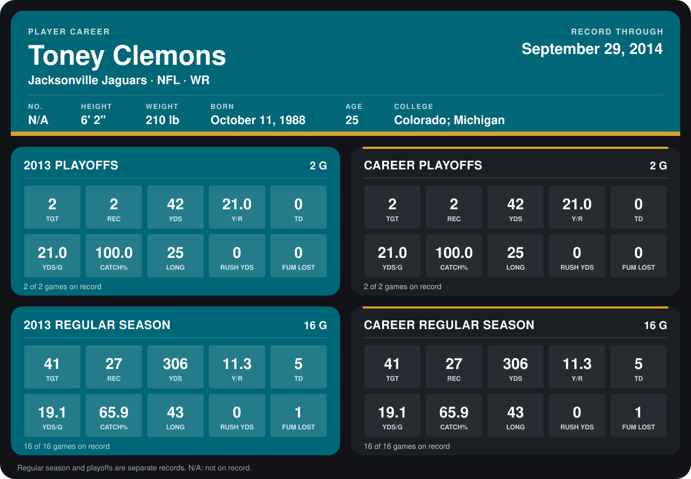

# Toney Clemons

## Career stats

### Regular season

| Season | Club | G | TGT | REC | YDS | Y/R | TD | YDS/G | CATCH% | LONG | RUSH YDS | FUM LOST |
|---|---|---:|---:|---:|---:|---:|---:|---:|---:|---:|---:|---:|
| 2013 | Jacksonville Jaguars | 16 | 41 | 27 | 306 | 11.3 | 5 | 19.1 | 65.9 | 43 | 0 | 1 |
| **Career** |  | 16 | 41 | 27 | 306 | 11.3 | 5 | 19.1 | 65.9 | 43 | 0 | 1 |

### Playoffs

| Season | Club | G | TGT | REC | YDS | Y/R | TD | YDS/G | CATCH% | LONG | RUSH YDS | FUM LOST |
|---|---|---:|---:|---:|---:|---:|---:|---:|---:|---:|---:|---:|
| 2013 | Jacksonville Jaguars | 2 | 2 | 2 | 42 | 21.0 | 0 | 21.0 | 100.0 | 25 | 0 | 0 |
| **Career** |  | 2 | 2 | 2 | 42 | 21.0 | 0 | 21.0 | 100.0 | 25 | 0 | 0 |

## Awards

None on record.

Records through September 29, 2014. Identity: the public player file's latest listing (no 2014 Weeks 1-4 roster row). [All Jacksonville Jaguars players](README.md).
