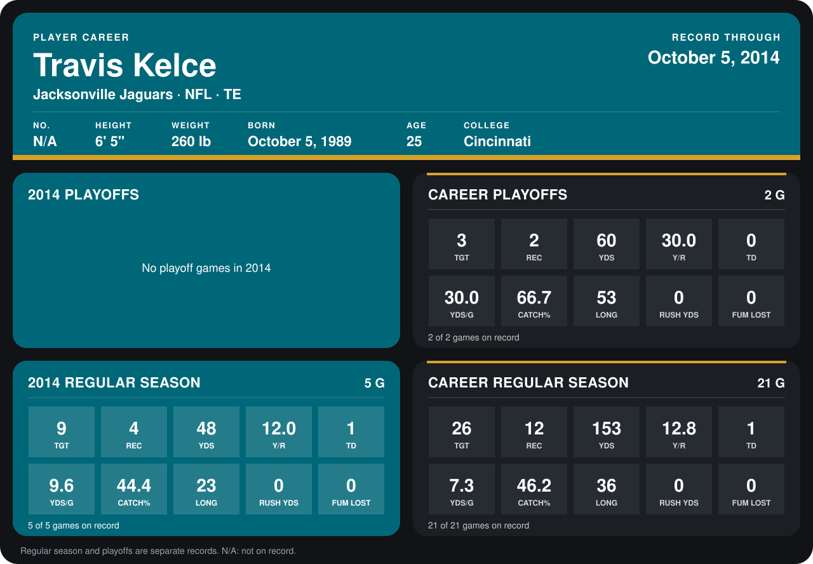

# Travis Kelce

## Career stats

### Regular season

| Season | Club | G | TGT | REC | YDS | Y/R | TD | YDS/G | CATCH% | LONG | RUSH YDS | FUM LOST |
|---|---|---:|---:|---:|---:|---:|---:|---:|---:|---:|---:|---:|
| 2013 | Jacksonville Jaguars | 16 | 17 | 8 | 105 | 13.1 | 0 | 6.6 | 47.1 | 36 | 0 | 0 |
| 2014 | Jacksonville Jaguars | 5 | 9 | 4 | 48 | 12.0 | 1 | 9.6 | 44.4 | 23 | 0 | 0 |
| **Career** |  | 21 | 26 | 12 | 153 | 12.8 | 1 | 7.3 | 46.2 | 36 | 0 | 0 |

### Playoffs

| Season | Club | G | TGT | REC | YDS | Y/R | TD | YDS/G | CATCH% | LONG | RUSH YDS | FUM LOST |
|---|---|---:|---:|---:|---:|---:|---:|---:|---:|---:|---:|---:|
| 2013 | Jacksonville Jaguars | 2 | 3 | 2 | 60 | 30.0 | 0 | 30.0 | 66.7 | 53 | 0 | 0 |
| **Career** |  | 2 | 3 | 2 | 60 | 30.0 | 0 | 30.0 | 66.7 | 53 | 0 | 0 |

## Awards

None on record.

[Jacksonville player card](../../2014/00_Team_Operations/Team/Player_Cards/travis_kelce.md)

Records through October 5, 2014. Identity: listed 2014 roster data, Weeks 1-4. [All Jacksonville Jaguars players](README.md).
