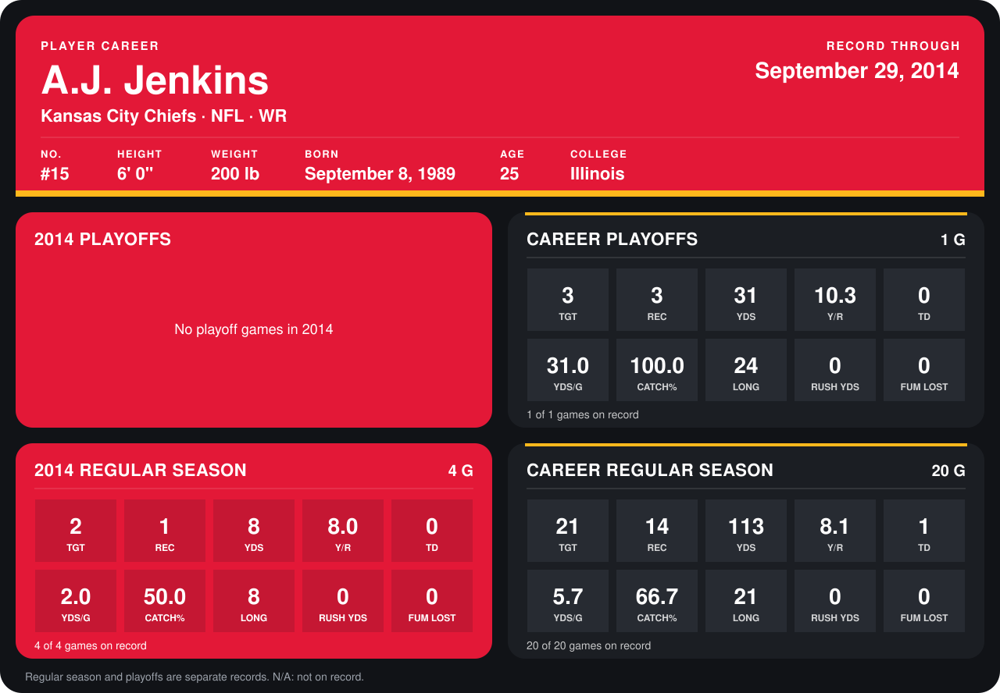

# A.J. Jenkins

## Career stats

### Regular season

| Season | Team | Age | # | G | TGT | REC | YDS | Y/R | TD | YDS/G | CATCH% | LONG | RUSH YDS | FUM LOST |
|---|---|---:|---:|---:|---:|---:|---:|---:|---:|---:|---:|---:|---:|---:|
| 2013 | Kansas City Chiefs | 23 | 15 | 16 | 19 | 13 | 105 | 8.1 | 1 | 6.6 | 68.4 | 21 | 0 | 0 |
| 2014 | Kansas City Chiefs | 24 | 15 | 5 | 3 | 2 | 17 | 8.5 | 0 | 3.4 | 66.7 | 9 | 0 | 0 |
| **Career** |  |  |  | 21 | 22 | 15 | 122 | 8.1 | 1 | 5.8 | 68.2 | 21 | 0 | 0 |

### Playoffs

| Season | Team | Age | # | G | TGT | REC | YDS | Y/R | TD | YDS/G | CATCH% | LONG | RUSH YDS | FUM LOST |
|---|---|---:|---:|---:|---:|---:|---:|---:|---:|---:|---:|---:|---:|---:|
| 2013 | Kansas City Chiefs | 23 | 15 | 1 | 3 | 3 | 31 | 10.3 | 0 | 31.0 | 100.0 | 24 | 0 | 0 |
| **Career** |  |  |  | 1 | 3 | 3 | 31 | 10.3 | 0 | 31.0 | 100.0 | 24 | 0 | 0 |

## Awards

None on record.

Age is his age on the league's opening game of each season; # is the number listed for him that season with that team (2014: the card's rule; 2013: the 2013 season roster), N/A where no listing applies.

Records through October 5, 2014. Identity: listed 2014 roster data, Weeks 1-4; number: 2014 Week 1 roster. [All Kansas City Chiefs players](README.md).
