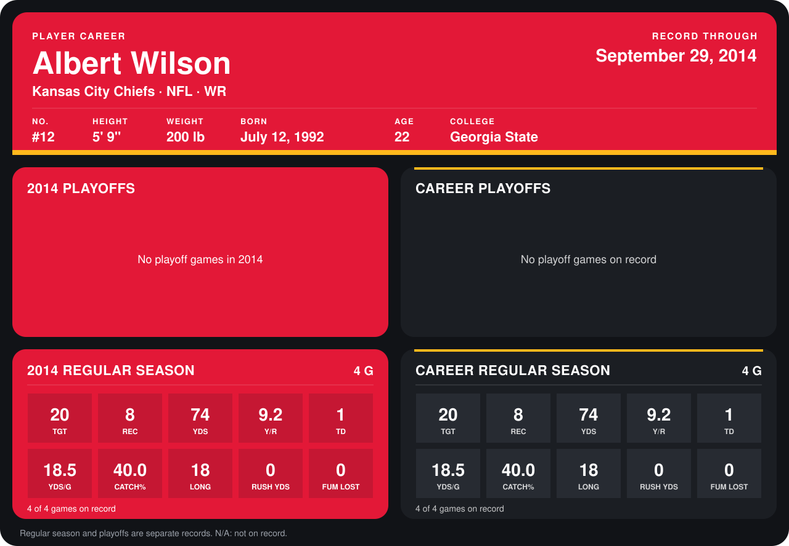

# Albert Wilson

## Career stats

### Regular season

| Season | Team | Age | # | G | TGT | REC | YDS | Y/R | TD | YDS/G | CATCH% | LONG | RUSH YDS | FUM LOST |
|---|---|---:|---:|---:|---:|---:|---:|---:|---:|---:|---:|---:|---:|---:|
| 2014 | Kansas City Chiefs | 22 | 12 | 4 | 20 | 8 | 74 | 9.2 | 1 | 18.5 | 40.0 | 18 | 0 | 0 |
| **Career** |  |  |  | 4 | 20 | 8 | 74 | 9.2 | 1 | 18.5 | 40.0 | 18 | 0 | 0 |

### Playoffs

No playoff games on record.

## Awards

None on record.

Age is his age on the league's opening game of each season; # is the number listed for him that season with that team (2014: the card's rule; 2013: the 2013 season roster), N/A where no listing applies.

Records through September 29, 2014. Identity: listed 2014 roster data, Weeks 1-4; number: 2014 Week 1 roster. [All Kansas City Chiefs players](README.md).
